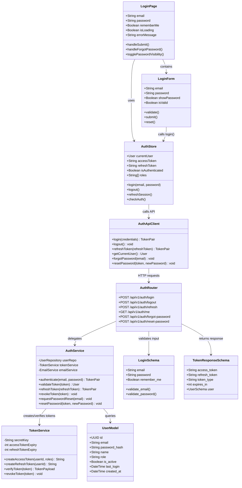
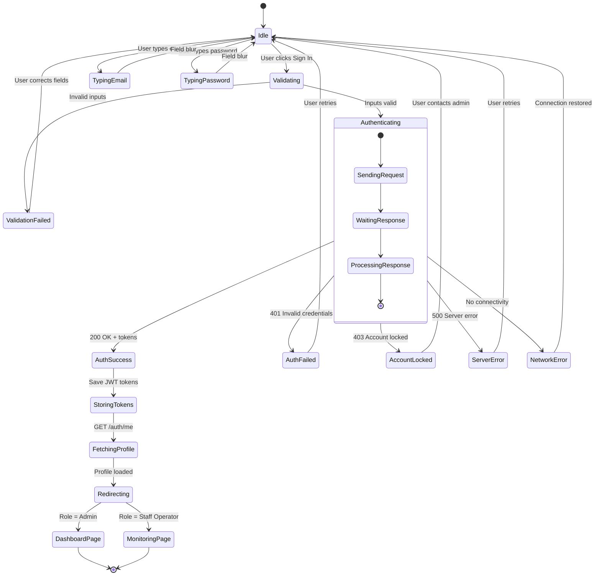

# Page 01 — Login / Authentication

**Route:** `/login`  
**Access:** All Roles  
**Purpose:** Authenticate users, manage sessions, and route to appropriate dashboard based on role.

---

## Page Content & Layout

### Components on Page

| Component | Type | Description |
|-----------|------|-------------|
| `LoginForm` | Form | Email + Password inputs with validation |
| `InstitutionLogo` | Image | Dynamic institution branding from config |
| `DeviceStatusBadge` | Badge | Shows Raspberry Pi online/offline status |
| `ForgotPasswordLink` | Link | Triggers password reset flow |
| `SessionExpiredAlert` | Alert | Displayed when redirected due to expired token |
| `LoginErrorToast` | Toast | Shows auth error messages |
| `LoadingSpinner` | Spinner | Shown during auth request |
| `RememberMeCheckbox` | Checkbox | Persist session across browser restarts |

### Buttons & Interactive Elements

| Element | ID | Action |
|---------|----|--------|
| Sign In Button | `btn-sign-in` | Submit credentials, authenticate |
| Forgot Password Link | `link-forgot-password` | Navigate to password reset |
| Remember Me Checkbox | `chk-remember-me` | Toggle session persistence |
| Show/Hide Password | `btn-toggle-password` | Toggle password visibility |

---

## Class Diagram

---

## State Diagram

---

## Feature-Action-Controller Map

| # | Feature | User Action | Frontend Controller | API Endpoint | Backend Service | Reaction / Side Effect |
|---|---------|-------------|-------------------|--------------|-----------------|----------------------|
| 1 | **Email Input** | Types email address | `LoginForm.validate()` | — | — | Real-time validation, red border on invalid |
| 2 | **Password Input** | Types password | `LoginForm.validate()` | — | — | Minimum length check, strength indicator |
| 3 | **Toggle Password** | Clicks eye icon | `LoginPage.togglePasswordVisibility()` | — | — | Input type switches text ↔ password |
| 4 | **Remember Me** | Checks/unchecks box | `LoginPage.rememberMe` toggle | — | — | Controls localStorage vs sessionStorage for tokens |
| 5 | **Sign In** | Clicks Sign In button | `AuthStore.login()` | `POST /api/v1/auth/login` | `AuthService.authenticate()` | Validates credentials → returns JWT pair → stores tokens → redirects to dashboard |
| 6 | **Login Failure** | Submits wrong credentials | `AuthStore.login()` error handler | `POST /api/v1/auth/login` → 401 | `AuthService.authenticate()` raises | Toast error "Invalid email or password", increment failed attempt counter |
| 7 | **Account Lockout** | Too many failed attempts | `AuthStore.login()` error handler | `POST /api/v1/auth/login` → 403 | `AuthService.authenticate()` checks lockout | Display "Account locked. Contact admin.", log audit event |
| 8 | **Forgot Password** | Clicks "Forgot Password" | `LoginPage.handleForgotPassword()` | `POST /api/v1/auth/forgot-password` | `AuthService.requestPasswordReset()` | Sends reset email with token link |
| 9 | **Session Expired** | Redirected from protected page | `AuthStore.checkAuth()` | `POST /api/v1/auth/refresh` → 401 | `TokenService.verifyToken()` fails | Show "Session expired, please login again" alert |
| 10 | **Auto-Refresh Token** | Token nearing expiry | `AuthStore.refreshSession()` (auto) | `POST /api/v1/auth/refresh` | `AuthService.refreshToken()` | Silent token refresh, no user interruption |
| 11 | **Role-Based Redirect** | After successful login | SvelteKit `load()` function | `GET /api/v1/auth/me` | `AuthService.validateToken()` | Super/Inst Admin → `/dashboard`, Staff → `/dashboard/monitoring` |
| 12 | **Audit Logging** | Every login attempt | — (server-side) | — | `AuditService.log()` | Records IP, timestamp, success/failure, user agent |

---
