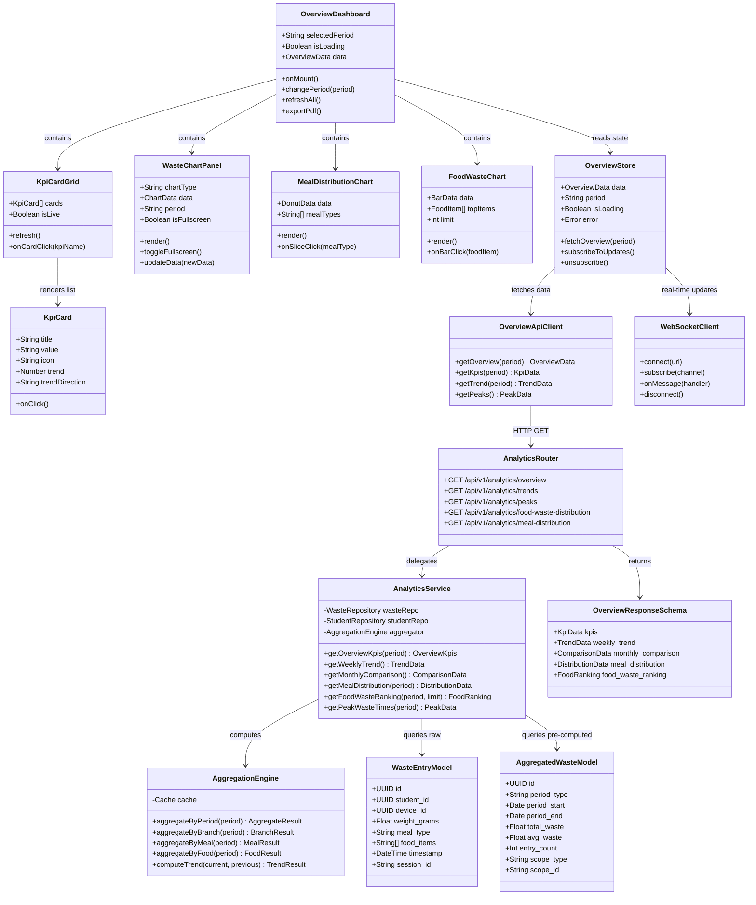
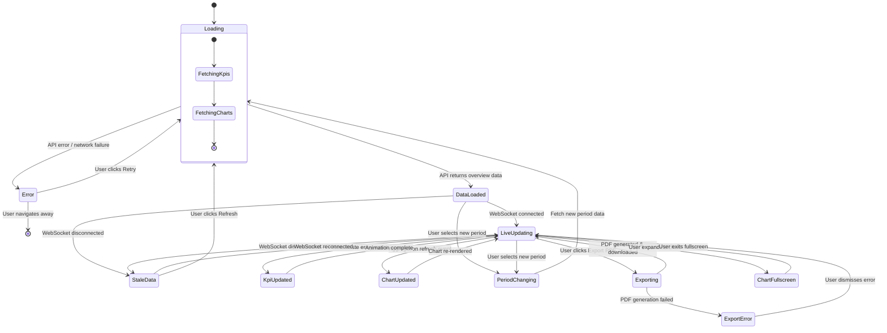

# Page 02 — Global Overview Dashboard

**Route:** `/dashboard`  
**Access:** Super Admin, Institution Admin, Mess Admin, Analytics Viewer (read-only)  
**Purpose:** Provide institution-wide operational visibility with KPI cards, trend charts, and real-time summaries.

---

## Page Content & Layout

### Sections

| Section | Position | Description |
|---------|----------|-------------|
| KPI Cards Row | Top | Grid of metric cards with live values |
| Weekly Waste Trend | Mid-Left | Line chart showing 7-day waste trend |
| Monthly Comparison | Mid-Right | Bar chart comparing current vs previous month |
| Meal Distribution | Bottom-Left | Donut chart of waste by meal type |
| Food Item Distribution | Bottom-Right | Horizontal bar chart of top wasted food items |

### KPI Cards

| Card | Value Source | Icon | Trend Indicator |
|------|-------------|------|-----------------|
| Total Waste Today | `analytics/overview?period=today` | Scale | ▲▼ vs yesterday |
| Total Waste This Week | `analytics/overview?period=week` | Calendar | ▲▼ vs last week |
| Total Waste This Month | `analytics/overview?period=month` | Chart | ▲▼ vs last month |
| Waste Reduction % | Computed delta | TrendDown | Green/Red badge |
| Peak Waste Time | `analytics/peaks` | Clock | Time label |
| Active Students | `students?status=active` count | Users | Total count |
| Students Under Warning | `students?warning_status=active` | AlertTriangle | Count + badge |
| Students Under Penalty | `students?penalty_status=active` | Ban | Count + badge |
| Active Devices | `devices?status=online` | Cpu | Green dot |
| Alerts Today | `notifications?type=alert&period=today` | Bell | Count |

### Buttons & Interactive Elements

| Element | ID | Action |
|---------|----|--------|
| Period Selector | `select-overview-period` | Switch between Today / Week / Month / Custom |
| Refresh Button | `btn-refresh-overview` | Force-refresh all KPIs and charts |
| Fullscreen Chart | `btn-fullscreen-{chartId}` | Expand any chart to full screen |
| Export Overview | `btn-export-overview` | Download overview as PDF |
| KPI Card Click | `card-{kpiName}` | Navigate to detailed analytics for that KPI |

---

## Class Diagram

---

## State Diagram

---

## Feature-Action-Controller Map

| # | Feature | User Action | Frontend Controller | API Endpoint | Backend Service | Reaction / Side Effect |
|---|---------|-------------|-------------------|--------------|-----------------|----------------------|
| 1 | **KPI Cards Display** | Page load | `OverviewStore.fetchOverview()` | `GET /api/v1/analytics/overview` | `AnalyticsService.getOverviewKpis()` | Renders KPI cards with values, trends, icons |
| 2 | **Period Switching** | Selects Today/Week/Month | `OverviewDashboard.changePeriod()` | `GET /api/v1/analytics/overview?period={p}` | `AnalyticsService.getOverviewKpis(period)` | All KPIs and charts re-fetch for new period |
| 3 | **Weekly Trend Chart** | Page load | `OverviewStore.fetchOverview()` | `GET /api/v1/analytics/trends?type=weekly` | `AnalyticsService.getWeeklyTrend()` | Line chart with 7 data points, tooltips on hover |
| 4 | **Monthly Comparison** | Page load | `OverviewStore.fetchOverview()` | `GET /api/v1/analytics/trends?type=monthly_comparison` | `AnalyticsService.getMonthlyComparison()` | Grouped bar chart: current vs previous month |
| 5 | **Meal Distribution** | Page load | `OverviewStore.fetchOverview()` | `GET /api/v1/analytics/meal-distribution` | `AnalyticsService.getMealDistribution()` | Donut chart with Breakfast/Lunch/Dinner segments |
| 6 | **Food Waste Ranking** | Page load | `OverviewStore.fetchOverview()` | `GET /api/v1/analytics/food-waste-distribution?limit=10` | `AnalyticsService.getFoodWasteRanking()` | Horizontal bar chart, top 10 wasted food items |
| 7 | **Live KPI Updates** | Automatic (WebSocket) | `WebSocketClient.onMessage()` | `WS /ws/dashboard` | `WebSocketService.broadcast()` | KPI card values animate to new numbers in real-time |
| 8 | **KPI Card Click** | Clicks a KPI card | `KpiCard.onClick()` → SvelteKit `goto()` | — | — | Navigate to detailed view (e.g., click "Under Warning" → `/dashboard/warnings`) |
| 9 | **Chart Fullscreen** | Clicks expand icon on chart | `WasteChartPanel.toggleFullscreen()` | — | — | Chart expands to modal overlay with larger view |
| 10 | **Refresh All** | Clicks refresh button | `OverviewStore.fetchOverview()` | `GET /api/v1/analytics/overview` | `AnalyticsService.getOverviewKpis()` | Force re-fetch all data, loading skeleton shown |
| 11 | **Export to PDF** | Clicks export button | `OverviewDashboard.exportPdf()` | `POST /api/v1/reports/generate` | `ReportService.generateOverviewReport()` | Generates PDF with all current KPIs and charts, triggers download |
| 12 | **Chart Hover Tooltip** | Hovers over chart data point | Chart.js tooltip handler | — | — | Shows exact value, date, and percentage change |

---
