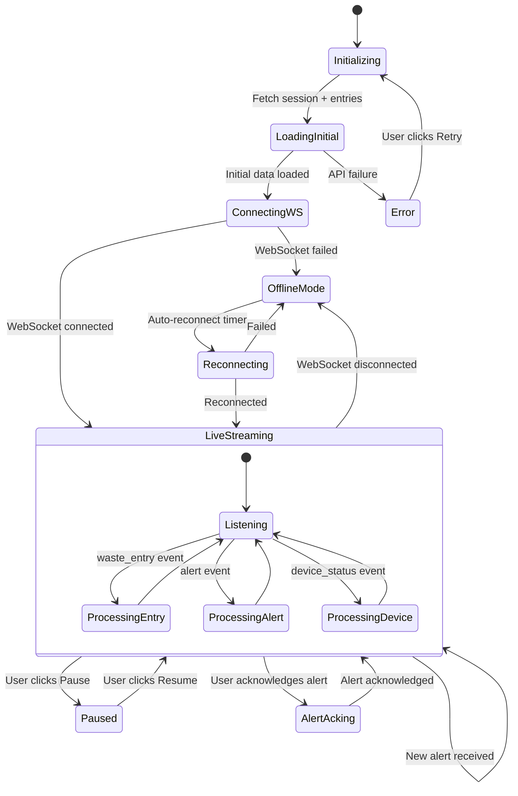

# Page 03 — Live Monitoring Dashboard

**Route:** `/dashboard/monitoring`  
**Access:** Super Admin, Institution Admin, Mess Admin, Analytics Viewer (read-only), Staff Operator (limited)  
**Purpose:** Real-time view of waste entries, live event stream, active sessions, device status, and instant alerts.

---

## Page Content & Layout

### Sections

| Section | Position | Description |
|---------|----------|-------------|
| Live Stats Bar | Top | Animated counters: entries today, active sessions, current meal |
| Real-Time Feed | Left Panel | Scrolling list of waste entries as they happen |
| Active Session Monitor | Center | Current meal session overview with live entry count |
| Device Status Grid | Right Panel | Grid of Raspberry Pi devices with health indicators |
| Alert Feed | Bottom-Left | Real-time alerts from rule engine |
| Live Waste Gauge | Bottom-Center | Animated gauge showing waste rate (g/min) |
| Session Timeline | Bottom-Right | Timeline of today's meal sessions |

### Buttons & Interactive Elements

| Element | ID | Action |
|---------|----|--------|
| Pause/Resume Feed | `btn-toggle-feed-pause` | Pause scrolling to inspect entries |
| Filter Feed by Meal | `select-feed-meal-filter` | Filter live feed by Breakfast/Lunch/Dinner |
| Acknowledge Alert | `btn-ack-alert-{id}` | Mark an alert as acknowledged |
| Device Detail | `btn-device-detail-{id}` | Open device health modal |
| Sound Toggle | `btn-toggle-sound` | Enable/disable alert sounds |
| Fullscreen Mode | `btn-fullscreen-monitoring` | Enter kiosk/fullscreen mode |

---

## Class Diagram

```mermaid
classDiagram
    direction TB

    class LiveMonitoringPage {
        +Boolean isPaused
        +String mealFilter
        +Boolean soundEnabled
        +onMount()
        +onDestroy()
        +togglePause()
        +toggleSound()
    }

    class RealTimeFeed {
        +WasteEntry[] entries
        +Boolean isPaused
        +String filter
        +addEntry(entry)
        +filterByMeal(meal)
        +pause()
        +resume()
    }

    class WasteEntryCard {
        +WasteEntry entry
        +String studentName
        +Float weight
        +String[] foodItems
        +String severityColor
        +onClick()
    }

    class DeviceStatusGrid {
        +DeviceStatus[] devices
        +refreshDevices()
        +onDeviceClick(deviceId)
    }

    class DeviceStatusCard {
        +String deviceId
        +String messName
        +String status
        +Float cpuUsage
        +Float ramUsage
        +Float temperature
        +getStatusColor()
    }

    class AlertFeed {
        +Alert[] alerts
        +int unacknowledgedCount
        +addAlert(alert)
        +acknowledge(alertId)
        +clearAcknowledged()
    }

    class LiveWasteGauge {
        +Float currentRate
        +Float threshold
        +updateRate(newRate)
        +getColor()
    }

    class MonitoringStore {
        +WasteEntry[] liveEntries
        +Alert[] liveAlerts
        +DeviceStatus[] devices
        +MealSession currentSession
        +connect()
        +disconnect()
        +handleWasteEvent(event)
        +handleAlertEvent(event)
    }

    class MonitoringApiClient {
        +getCurrentSession() MealSession
        +getDeviceStatuses() DeviceStatus[]
        +getRecentEntries(limit) WasteEntry[]
        +acknowledgeAlert(alertId) void
    }

    class MonitoringRouter {
        +GET /api/v1/monitoring/current-session
        +GET /api/v1/monitoring/recent-entries
        +GET /api/v1/monitoring/device-statuses
        +POST /api/v1/monitoring/alerts/{id}/acknowledge
        +WS /ws/monitoring
    }

    class MonitoringService {
        -WasteRepository wasteRepo
        -DeviceRepository deviceRepo
        -AlertRepository alertRepo
        +getCurrentSession() MealSession
        +getRecentEntries(limit) WasteEntry[]
        +getDeviceStatuses() DeviceStatus[]
        +acknowledgeAlert(alertId, userId) void
    }

    class AlertModel {
        +UUID id
        +String type
        +String priority
        +String message
        +Boolean acknowledged
        +DateTime created_at
    }

    LiveMonitoringPage --> RealTimeFeed : contains
    LiveMonitoringPage --> DeviceStatusGrid : contains
    LiveMonitoringPage --> AlertFeed : contains
    LiveMonitoringPage --> LiveWasteGauge : contains
    LiveMonitoringPage --> MonitoringStore : reads state
    RealTimeFeed --> WasteEntryCard : renders list
    DeviceStatusGrid --> DeviceStatusCard : renders list
    MonitoringStore --> MonitoringApiClient : initial fetch
    MonitoringApiClient --> MonitoringRouter : HTTP requests
    MonitoringRouter --> MonitoringService : delegates
    MonitoringService --> AlertModel : queries
```

---

## State Diagram



---

## Feature-Action-Controller Map

| # | Feature | User Action | Frontend Controller | API Endpoint | Backend Service | Reaction / Side Effect |
|---|---------|-------------|-------------------|--------------|-----------------|----------------------|
| 1 | **Initial Load** | Page mount | `MonitoringStore.connect()` | `GET /api/v1/monitoring/current-session` + `recent-entries` | `MonitoringService.*()` | Fetches initial data, then opens WebSocket |
| 2 | **Live Waste Feed** | Automatic (WebSocket) | `MonitoringStore.handleWasteEvent()` | `WS /ws/monitoring` → `waste_entry` | `EventService.publish()` | New entry card slides into feed with animation |
| 3 | **Pause Feed** | Clicks pause button | `RealTimeFeed.pause()` | — | — | Feed stops scrolling, entries queue silently |
| 4 | **Resume Feed** | Clicks resume button | `RealTimeFeed.resume()` | — | — | Queued entries flush into feed |
| 5 | **Filter by Meal** | Selects meal dropdown | `RealTimeFeed.filterByMeal()` | — | — | Feed shows only selected meal type |
| 6 | **Live Alert** | Automatic (WebSocket) | `MonitoringStore.handleAlertEvent()` | `WS /ws/monitoring` → `alert` | `RuleEngine` | Alert card appears with priority color |
| 7 | **Acknowledge Alert** | Clicks ack button | `AlertFeed.acknowledge()` | `POST /api/v1/monitoring/alerts/{id}/acknowledge` | `MonitoringService.acknowledgeAlert()` | Alert greys out, audit log entry created |
| 8 | **Device Status** | Page load + WebSocket | `DeviceStatusGrid` | `GET /api/v1/monitoring/device-statuses` | `DeviceService` | Device cards with green/yellow/red status |
| 9 | **Device Detail** | Clicks device card | `DeviceStatusGrid.onDeviceClick()` | `GET /api/v1/devices/{id}/health` | `DeviceService.getDeviceHealth()` | Modal with CPU, RAM, temp graphs |
| 10 | **Waste Gauge** | Automatic (computed) | `LiveWasteGauge.updateRate()` | — | — | Animated gauge showing g/min rate |
| 11 | **Sound Alerts** | Toggles sound button | `LiveMonitoringPage.toggleSound()` | — | — | Audio plays on critical alerts |
| 12 | **Auto-Reconnect** | WebSocket disconnects | Auto-retry logic | `WS /ws/monitoring` | — | "Reconnecting..." banner, retries every 3s |
| 13 | **Entry Detail** | Clicks feed entry | `WasteEntryCard.onClick()` | `GET /api/v1/waste/entries/{id}` | `WasteService.getEntry()` | Modal: student, food items, weight, image |

---
