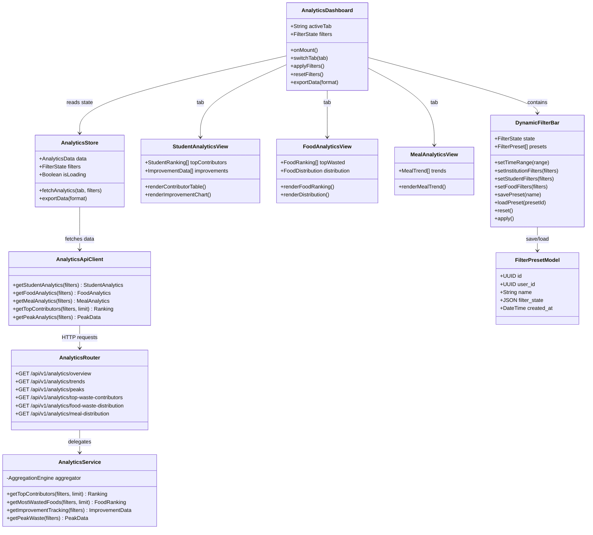
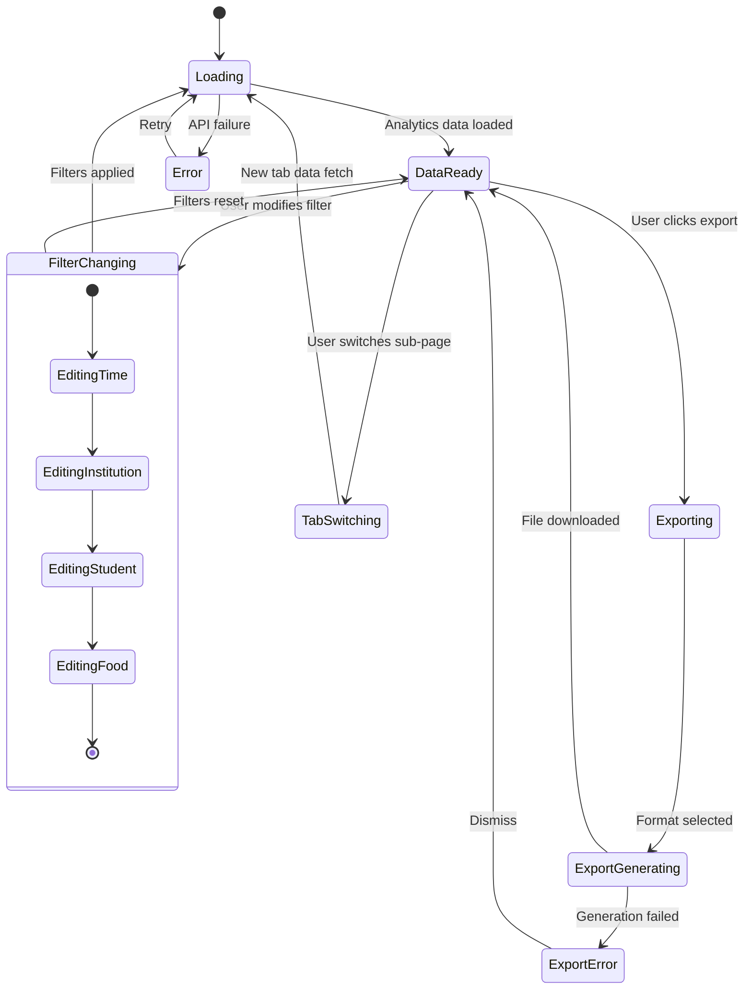

# Page 04 — Analytics Dashboard

**Route:** `/dashboard/analytics/*` (sub-routes: `/student`, `/food`, `/meal`)  
**Access:** Super Admin, Institution Admin, Mess Admin, Analytics Viewer (read-only)  
**Purpose:** Deep-dive analytics with dynamic filters, trends, and peak detection per student device ID.

---

## Page Content & Layout

### Sub-Pages

| Sub-Page | Route | Primary Charts |
|----------|-------|---------------|
| Student Analytics | `/analytics/student` | Top waste contributors table, improvement tracking |
| Food Analytics | `/analytics/food` | Most wasted foods, food waste distribution |
| Meal Analytics | `/analytics/meal` | Meal-wise trend, meal comparison |

### Shared Components (All Sub-Pages)

| Component | Type | Description |
|-----------|------|-------------|
| `DynamicFilterBar` | Filter Panel | Collapsible panel with all filter types |
| `TimeRangeSelector` | Dropdown + DatePicker | Today/7d/30d/Semester/Custom |
| `StudentFilter` | Search + Multi-Select | Device ID, Status |
| `FoodFilter` | Multi-Select | Meal type, Category, Specific item |
| `FilterPresetManager` | Dropdown + Save | Save/load named filter presets |
| `ExportButton` | Button | Export current view as PDF/CSV/Excel |

### Buttons & Interactive Elements

| Element | ID | Action |
|---------|----|--------|
| Apply Filters | `btn-apply-filters` | Re-fetch data with current filters |
| Reset Filters | `btn-reset-filters` | Clear all filters to defaults |
| Save Preset | `btn-save-preset` | Save current filter combo as named preset |
| Load Preset | `select-preset` | Load a saved filter preset |
| Export PDF | `btn-export-pdf` | Export analytics as PDF |
| Export CSV | `btn-export-csv` | Export data as CSV |
| Tab Navigation | `tab-{subpage}` | Switch between analytics sub-pages |

---

## Class Diagram

---

## State Diagram

---

## Feature-Action-Controller Map

| # | Feature | User Action | Frontend Controller | API Endpoint | Backend Service | Reaction / Side Effect |
|---|---------|-------------|-------------------|--------------|-----------------|----------------------|
| 1 | **Tab Navigation** | Clicks sub-page tab | `AnalyticsDashboard.switchTab()` | Varies by tab | Varies by tab | Loads tab-specific analytics data |
| 2 | **Time Filter** | Selects period | `DynamicFilterBar.setTimeRange()` | All endpoints with `?start_date=&end_date=` | All services | All charts re-render for new period |
| 3 | **Student Filter** | Searches by device ID/status | `DynamicFilterBar.setStudentFilters()` | Endpoints with `?device_id=&status=` | Services filter by student | Analytics filtered by selected student |
| 4 | **Food Filter** | Selects food/meal type | `DynamicFilterBar.setFoodFilters()` | Endpoints with `?meal_type=&food=` | Services filter by food | Charts show only selected food data |
| 5 | **Apply Filters** | Clicks Apply | `AnalyticsStore.fetchAnalytics()` | Multiple GET endpoints | Multiple services | All visible charts and tables refresh |
| 6 | **Save Preset** | Clicks save, enters name | `DynamicFilterBar.savePreset()` | `POST /api/v1/filters/presets` | `FilterService.savePreset()` | Filter combo saved for future use |
| 7 | **Load Preset** | Selects preset | `DynamicFilterBar.loadPreset()` | `GET /api/v1/filters/presets/{id}` | `FilterService.getPreset()` | All filters populate from saved state |
| 8 | **Top Contributors** | Views student analytics tab | `StudentAnalyticsView` | `GET /api/v1/analytics/top-waste-contributors` | `AnalyticsService.getTopContributors()` | Ranked table: device ID → mapped name, avg waste, violations |
| 9 | **Most Wasted Foods** | Views food analytics tab | `FoodAnalyticsView` | `GET /api/v1/analytics/food-waste-distribution` | `AnalyticsService.getMostWastedFoods()` | Horizontal bar chart of top wasted food items |
| 10 | **Peak Analytics** | Views any tab | Embedded in views | `GET /api/v1/analytics/peaks` | `AnalyticsService.getPeakWaste()` | Highlights peak waste hours, meals, weekdays |
| 11 | **Export PDF** | Clicks export PDF | `AnalyticsStore.exportData('pdf')` | `POST /api/v1/reports/generate` | `ReportService.generate()` | PDF with current filters and charts |
| 12 | **Export CSV** | Clicks export CSV | `AnalyticsStore.exportData('csv')` | `GET /api/v1/analytics/*/export?format=csv` | `ReportService.exportCsv()` | CSV download of raw filtered data |

---
