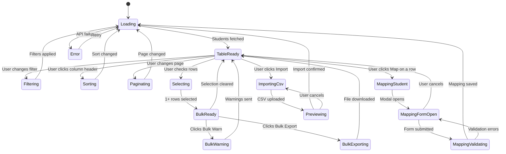

# Page 05 — Students List Page

**Route:** `/dashboard/students`  
**Access:** Super Admin, Institution Admin, Mess Admin, Analytics Viewer (read-only)  
**Purpose:** List all registered device IDs with status indicators. Admins manually map each device ID to a student's name, roll number, year, and branch. Once mapped, filtered search and full analytics become available.

---

## Page Content & Layout

### Sections

| Section | Position | Description |
|---------|----------|-------------|
| Search & Filter Bar | Top | Search box + filter dropdowns + status toggles |
| Summary Stats | Below Filters | Quick counts: Total, Active, Warning, Penalty, Green |
| Students Table | Main Content | Paginated data table with all student info |
| Bulk Actions Bar | Sticky Bottom | Appears when rows are selected |

### Table Columns

| Column | Sortable | Description |
|--------|----------|-------------|
| Checkbox | — | Row selection for bulk actions |
| Status Indicator | ✅ | Green/Yellow/Orange/Red dot based on waste level |
| Device ID | ✅ | System-assigned unique student device ID |
| Mapped Name | ✅ | Student name (shown only after ID mapping, else —) |
| Warnings | ✅ | Active warning count |
| Actions | — | Map / Edit Mapping buttons |

### Buttons & Interactive Elements

| Element | ID | Action |
|---------|----|--------|
| Status Filter | `select-filter-status` | Filter by Green/Yellow/Orange/Red |
| Hostel Filter | `select-filter-hostel` | Filter by hostel (available after mapping) |
| Map Student ID | `btn-map-{deviceId}` | Open mapping modal to assign name/roll/year/branch — **[M7-audit-fix]** API call uses student `id` (UUID), not `deviceId` |
| Import CSV | `btn-import-csv` | Bulk import student mappings from CSV |
| Export List | `btn-export-students` | Export filtered list as CSV/Excel |
| Select All | `chk-select-all` | Toggle select all visible rows |
| Bulk Warn | `btn-bulk-warn` | Send warning to selected students |
| Bulk Export | `btn-bulk-export` | Export selected student data |
| Pagination | `nav-pagination` | Navigate pages |
| Page Size | `select-page-size` | 10/25/50/100 per page |

### ID Mapping Feature

> **How it works:** The system generates a unique `device_id` for each student card/tag at registration. Initially only the `device_id` exists. An admin opens the **Map Student** modal and assigns: Full Name, Roll Number, Year, and Branch. Once mapped, the student row shows their real identity and all analytics become searchable by name/roll/branch/year.

| Field | Required | Notes |
|-------|----------|-------|
| Device ID | ✅ (auto) | System-generated, read-only |
| Full Name | ✅ | Manually entered by admin |
| Roll Number | ✅ | Unique institutional identifier |
| Year | ✅ | Academic year (1–4) |
| Branch | ✅ | e.g. CSE, ECE, ME, CE |
| Hostel | ❓ Optional | Hostel block if applicable |

---

## Class Diagram

```mermaid
classDiagram
    direction TB

    class StudentsListPage {
        +FilterState filters
        +SortState sort
        +int page
        +int pageSize
        +Student[] selectedStudents
        +onMount()
        +applyFilters()
        +sort(column, direction)
        +changePage(page)
        +selectAll()
        +bulkAction(action)
        +openMapModal(deviceId)
    }

    class StudentFilterPanel {
        +String status
        +String hostel
        +apply()
        +reset()
    }

    class StudentTable {
        +Student[] students
        +SortState sort
        +UUID[] selectedIds
        +onSort(column)
        +onSelect(studentId)
        +onSelectAll()
        +onRowClick(studentId)
    }

    class StudentRow {
        +Student student
        +Boolean isSelected
        +Boolean isMapped
        +getStatusColor()
        +onMap()
        +onSelect()
    }

    class BulkActionsBar {
        +int selectedCount
        +onBulkWarn()
        +onBulkExport()
        +onClearSelection()
    }

    class PaginationControl {
        +int currentPage
        +int totalPages
        +int pageSize
        +int totalItems
        +goToPage(page)
        +changePageSize(size)
    }

    class MapStudentModal {
        +String deviceId
        +StudentMappingData formData
        +Boolean isOpen
        +validate()
        +submit()
        +close()
    }

    class ImportCsvModal {
        +File csvFile
        +ImportResult result
        +upload()
        +preview()
        +confirm()
    }

    class StudentsStore {
        +Student[] students
        +int totalCount
        +int page
        +int pageSize
        +Boolean isLoading
        +fetchStudents(filters, sort, page)
        +mapStudent(deviceId, data)
        +importMappingCsv(file)
        +exportList(format)
    }

    class StudentsApiClient {
        +getStudents(params) PaginatedStudents
        +getStudent(id) Student
        +mapStudent(studentId, data) Student
        +importMappingCsv(file) ImportResult
        +exportStudents(format, filters) Blob
        +bulkWarn(studentIds) void
    }

    class StudentRouter {
        +GET /api/v1/students
        +GET /api/v1/students/{id}
        +POST /api/v1/students/{id}/map
        +PATCH /api/v1/students/{id}/map
        +POST /api/v1/students/import-mapping
        +GET /api/v1/students/export
        +POST /api/v1/students/bulk/warn
    }

    class StudentService {
        -StudentRepository repo
        +listStudents(filters, sort, pagination) PaginatedResult
        +mapStudentId(deviceId, data) Student
        +importMappingFromCsv(file) ImportResult
        +exportStudents(format, filters) FileBytes
        +bulkWarn(studentIds, reason) void
    }

    class StudentModel {
        +UUID id
        +String device_id
        +String status
        +Int warning_count
        +DateTime created_at
    }

    class StudentMappingModel {
        +UUID id
        +String device_id
        +String name
        +String roll_number
        +String branch
        +Int year
        +String hostel
        +String room_number
        +UUID mapped_by
        +DateTime mapped_at
    }

    StudentsListPage --> StudentFilterPanel : contains
    StudentsListPage --> StudentTable : contains
    StudentsListPage --> BulkActionsBar : contains
    StudentsListPage --> PaginationControl : contains
    StudentsListPage --> MapStudentModal : opens
    StudentsListPage --> ImportCsvModal : opens
    StudentsListPage --> StudentsStore : reads state
    StudentTable --> StudentRow : renders list
    StudentsStore --> StudentsApiClient : fetches data
    StudentsApiClient --> StudentRouter : HTTP requests
    StudentRouter --> StudentService : delegates
    StudentService --> StudentModel : queries
    StudentService --> StudentMappingModel : creates/updates
```

---

## State Diagram



---

## Feature-Action-Controller Map

| # | Feature | User Action | Frontend Controller | API Endpoint | Backend Service | Reaction / Side Effect |
|---|---------|-------------|-------------------|--------------|-----------------|----------------------|
| 1 | **Load Students** | Page mount | `StudentsStore.fetchStudents()` | `GET /api/v1/students?page=1&size=25` | `StudentService.listStudents()` | Table renders: device ID, mapping status, warnings, status dot |
| 2 | **Filter by Status** | Selects status | `StudentFilterPanel.apply()` | `GET /api/v1/students?status=red` | `StudentService.listStudents()` | Table shows only students with that status |
| 3 | **Filter by Hostel** | Selects hostel (mapped students only) | `StudentFilterPanel.apply()` | `GET /api/v1/students?hostel=A` | `StudentService.listStudents()` | Table shows students from selected hostel |
| 4 | **Sort Column** | Clicks column header | `StudentTable.onSort()` | `GET /api/v1/students?sort=warnings&order=desc` | `StudentService.listStudents()` | Column sorts asc/desc with arrow indicator |
| 5 | **Pagination** | Clicks page number | `PaginationControl.goToPage()` | `GET /api/v1/students?page=3` | `StudentService.listStudents()` | Table loads next page of students |
| 6 | **Map Student ID** | Clicks Map button on a row | `MapStudentModal.submit()` | `POST /api/v1/students/{id}/map` | `StudentService.mapStudentId()` | Device ID gets name/roll/year/branch assigned; row updates to show mapped identity — **[M7-audit-fix]** URL path uses student UUID (`student.id`), NOT `device_id` |
| 7 | **Edit Mapping** | Clicks Edit Mapping on mapped row | `MapStudentModal` pre-filled | `PATCH /api/v1/students/{id}/map` | `StudentService.mapStudentId()` | Existing mapping updated in DB — **[M7-audit-fix]** URL path uses student UUID |
| 8 | **Import Mapping CSV** | Uploads CSV with device_id,name,roll,year,branch | `ImportCsvModal.upload()` | `POST /api/v1/students/import-mapping` | `StudentService.importMappingFromCsv()` | Preview shows parsed rows; confirm to bulk-map all device IDs |
| 9 | **Export List** | Clicks export button | `StudentsStore.exportList()` | `GET /api/v1/students/export?format=csv` | `StudentService.exportStudents()` | CSV/Excel file downloads with all mapped/unmapped records |
| 10 | **Select Rows** | Checks checkboxes | `StudentTable.onSelect()` | — | — | Bulk actions bar appears at bottom |
| 11 | **Bulk Warn** | Clicks bulk warn | `BulkActionsBar.onBulkWarn()` | `POST /api/v1/students/bulk/warn` | `StudentService.bulkWarn()` | Warnings sent, notifications created |
| 12 | **Status Dot Color** | Visual indicator (auto) | Computed from waste data | — | — | Green (<50g avg), Yellow (50–100g), Orange (100–150g), Red (>150g) |
| 13 | **Unmapped Badge** | Visual indicator on unmapped rows | Computed from mapping data | — | — | Shows “Unmapped” tag in Mapped Name column until admin maps the ID |

---
