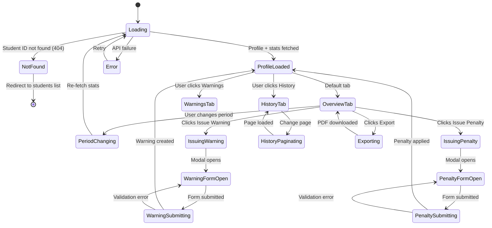

# Page 06 — Student Intelligence Dashboard

**Route:** `/dashboard/students/[id]`  
**Access:** Super Admin, Institution Admin, Mess Admin, Analytics Viewer (read-only)  
**Purpose:** Deep-dive into an individual student's waste profile, behavioral metrics, timeline analytics, and history.

---

## Page Content & Layout

### Sections

| Section | Position | Description |
|---------|----------|-------------|
| Student Profile Header | Top | Avatar, name, roll, branch, year, hostel, room, status badge |
| Quick Stats Cards | Below Header | 4 KPI cards: Avg Waste, Sustainability Score, Warnings, Penalties |
| Waste Timeline Chart | Mid-Left | Line chart of daily waste over time |
| Food Breakdown | Mid-Right | Donut chart of waste by food item |
| Meal Pattern Chart | Bottom-Left | Bar chart of waste by meal type |
| Improvement Tracker | Bottom-Center | Trend line showing improvement % over weeks |
| History Table | Bottom-Full | Paginated table of all waste entries for this student |
| Warning/Penalty Log | Sidebar/Tab | Chronological list of warnings and penalties |

### Buttons & Interactive Elements

| Element | ID | Action |
|---------|----|--------|
| Back to List | `btn-back-students` | Navigate back to students list |
| Period Selector | `select-student-period` | Switch timeline: 7d/30d/Semester/All |
| Issue Warning | `btn-issue-warning` | Manually issue a warning |
| Issue Penalty | `btn-issue-penalty` | Manually apply a penalty |
| Send Notification | `btn-send-notification` | Send custom notification to this student |
| Export Profile | `btn-export-profile` | Export student report as PDF |
| Edit Student | `btn-edit-student` | Edit student profile info |
| Tab: Overview | `tab-overview` | Show charts and stats |
| Tab: History | `tab-history` | Show waste entry history table |
| Tab: Warnings | `tab-warnings` | Show warning/penalty log |

---

## Class Diagram

```mermaid
classDiagram
    direction TB

    class StudentIntelligencePage {
        +UUID studentId
        +String activeTab
        +String period
        +StudentProfile profile
        +onMount()
        +switchTab(tab)
        +changePeriod(period)
        +issueWarning()
        +issuePenalty()
        +sendNotification()
        +exportProfile()
    }

    class StudentProfileHeader {
        +String name
        +String rollNumber
        +String branch
        +String year
        +String hostel
        +String roomNumber
        +String status
        +String avatarUrl
        +getStatusBadge()
    }

    class StudentKpiCards {
        +Float avgWaste
        +Float sustainabilityScore
        +Int warningCount
        +Int penaltyCount
        +Float improvementPct
        +getTrendArrow(metric)
    }

    class WasteTimelineChart {
        +TimelinePoint[] data
        +String period
        +Float threshold
        +render()
        +onPointClick(date)
    }

    class FoodBreakdownChart {
        +FoodSlice[] data
        +render()
        +onSliceClick(food)
    }

    class MealPatternChart {
        +MealBar[] data
        +render()
    }

    class ImprovementTracker {
        +TrendPoint[] data
        +Float currentImprovement
        +String direction
        +render()
    }

    class WasteHistoryTable {
        +WasteEntry[] entries
        +int page
        +int totalPages
        +onPageChange(page)
        +onEntryClick(entryId)
    }

    class WarningPenaltyLog {
        +Warning[] warnings
        +Penalty[] penalties
        +renderTimeline()
    }

    class IssueWarningModal {
        +String reason
        +String level
        +Boolean sendEmail
        +submit()
        +close()
    }


    class StudentIntelligenceStore {
        +StudentProfile profile
        +WasteStats stats
        +WasteEntry[] history
        +Warning[] warnings
        +Boolean isLoading
        +fetchProfile(id)
        +fetchStats(id, period)
        +fetchHistory(id, page)
        +fetchWarnings(id)
        +issueWarning(id, data)
        +issuePenalty(id, data)
    }

    class StudentIntelligenceApiClient {
        +getProfile(id) StudentProfile
        +getStats(id, period) WasteStats
        +getTimeline(id, period) TimelineData
        +getFoodBreakdown(id, period) FoodData
        +getMealPattern(id, period) MealData
        +getImprovement(id) ImprovementData
        +getHistory(id, page) PaginatedEntries
        +getWarnings(id) WarningList
        +issueWarning(id, data) Warning
        +issuePenalty(id, data) Penalty
    }

    class StudentRouter {
        +GET /api/v1/students/{id}
        +GET /api/v1/students/{id}/stats
        +GET /api/v1/students/{id}/timeline
        +GET /api/v1/students/{id}/food-breakdown
        +GET /api/v1/students/{id}/meal-pattern
        +GET /api/v1/students/{id}/improvement
        +GET /api/v1/students/{id}/history
        +GET /api/v1/students/{id}/warnings
        +POST /api/v1/students/{id}/warnings
        +POST /api/v1/students/{id}/penalties
    }

    class StudentIntelligenceService {
        -StudentRepository repo
        -WasteRepository wasteRepo
        -WarningRepository warnRepo
        -SustainabilityScorer scorer
        +getFullProfile(id) StudentProfile
        +getWasteStats(id, period) WasteStats
        +getWasteTimeline(id, period) TimelineData
        +getFoodBreakdown(id, period) FoodData
        +getImprovementTrend(id) ImprovementData
        +issueWarning(id, data) Warning
        +issuePenalty(id, data) Penalty
    }

    class WarningModel {
        +UUID id
        +UUID student_id
        +String level
        +String reason
        +UUID issued_by
        +Boolean email_sent
        +DateTime created_at
    }

    class PenaltyModel {
        +UUID id
        +UUID student_id
        +Int points
        +String reason
        +UUID issued_by
        +String status
        +DateTime created_at
    }

    StudentIntelligencePage --> StudentProfileHeader : contains
    StudentIntelligencePage --> StudentKpiCards : contains
    StudentIntelligencePage --> WasteTimelineChart : tab overview
    StudentIntelligencePage --> FoodBreakdownChart : tab overview
    StudentIntelligencePage --> MealPatternChart : tab overview
    StudentIntelligencePage --> ImprovementTracker : tab overview
    StudentIntelligencePage --> WasteHistoryTable : tab history
    StudentIntelligencePage --> WarningPenaltyLog : tab warnings
    StudentIntelligencePage --> IssueWarningModal : opens
    StudentIntelligencePage --> StudentIntelligenceStore : reads state
    StudentIntelligenceStore --> StudentIntelligenceApiClient : fetches
    StudentIntelligenceApiClient --> StudentRouter : HTTP requests
    StudentRouter --> StudentIntelligenceService : delegates
    StudentIntelligenceService --> WarningModel : queries/creates
    StudentIntelligenceService --> PenaltyModel : queries/creates
```

---

## State Diagram



---

## Feature-Action-Controller Map

| # | Feature | User Action | Frontend Controller | API Endpoint | Backend Service | Reaction / Side Effect |
|---|---------|-------------|-------------------|--------------|-----------------|----------------------|
| 1 | **Load Profile** | Page mount | `StudentIntelligenceStore.fetchProfile()` | `GET /api/v1/students/{id}` | `StudentIntelligenceService.getFullProfile()` | Header renders: name, roll, branch, status badge |
| 2 | **Load Stats** | Page mount | `StudentIntelligenceStore.fetchStats()` | `GET /api/v1/students/{id}/stats?period=30d` | `StudentIntelligenceService.getWasteStats()` | KPI cards populate: avg waste, score, warnings, penalties |
| 3 | **Waste Timeline** | Page mount | Auto-render | `GET /api/v1/students/{id}/timeline?period=30d` | `StudentIntelligenceService.getWasteTimeline()` | Line chart with daily waste points, threshold line shown |
| 4 | **Food Breakdown** | Page mount | Auto-render | `GET /api/v1/students/{id}/food-breakdown` | `StudentIntelligenceService.getFoodBreakdown()` | Donut chart: Rice 40%, Dal 20%, Sabzi 15%, etc. |
| 5 | **Meal Pattern** | Page mount | Auto-render | `GET /api/v1/students/{id}/meal-pattern` | Service method | Bar chart: Breakfast vs Lunch vs Dinner waste |
| 6 | **Improvement Trend** | Page mount | Auto-render | `GET /api/v1/students/{id}/improvement` | `StudentIntelligenceService.getImprovementTrend()` | Trend line with % improvement over weeks |
| 7 | **Period Change** | Selects period | `StudentIntelligencePage.changePeriod()` | Multiple endpoints with `?period=` | Multiple services | All overview charts re-render for new period |
| 8 | **History Tab** | Clicks History tab | `WasteHistoryTable` renders | `GET /api/v1/students/{id}/history?page=1` | Service method | Paginated table: date, meal, food items, weight, session |
| 9 | **Warnings Tab** | Clicks Warnings tab | `WarningPenaltyLog` renders | `GET /api/v1/students/{id}/warnings` | Service method | Chronological list of all warnings and penalties |
| 10 | **Issue Warning** | Clicks warn, fills form | `IssueWarningModal.submit()` | `POST /api/v1/students/{id}/warnings` | `StudentIntelligenceService.issueWarning()` | Warning created, email sent if checked, audit log |
| 11 | **Issue Penalty** | Clicks penalty, fills form | Modal submit | `POST /api/v1/students/{id}/penalties` | `StudentIntelligenceService.issuePenalty()` | Penalty applied, student status may change to Red |
| 12 | **Send Notification** | Clicks notify button | Modal submit | `POST /api/v1/notifications` | `NotificationService.send()` | Custom notification sent to student email |
| 13 | **Export Profile** | Clicks export | `StudentIntelligencePage.exportProfile()` | `POST /api/v1/reports/generate` | `ReportService.generateStudentReport()` | PDF with all charts, stats, history downloaded |
| 15 | **Status Badge Color** | Visual (auto) | Computed | — | — | Green (<50g), Yellow (50-100g), Orange (100-150g), Red (>150g) |
| 16 | **Edit Student** | Clicks edit | `EditStudentModal` | `PATCH /api/v1/students/{id}` | `StudentService.updateStudent()` | Profile info updated (hostel, room, etc.) |

---
