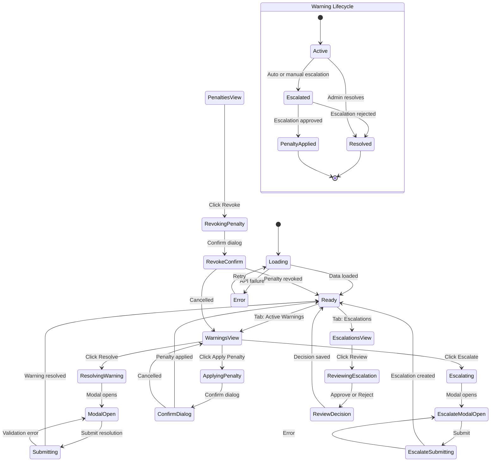

# Page 07 — Warnings & Penalties Page

**Route:** `/dashboard/warnings`  
**Access:** Super Admin, Institution Admin, Mess Admin  
**Purpose:** Centralized management of all warnings and penalties — view, filter, acknowledge, escalate, and resolve.

---

## Page Content & Layout

### Sections

| Section | Position | Description |
|---------|----------|-------------|
| Summary Cards | Top | Total Warnings, Active Warnings, Pending Escalations, Total Penalties |
| Tab Bar | Below Cards | Tabs: Active Warnings / Escalation Queue |
| Filter Bar | Below Tabs | Filter by status, priority, date range |
| Warnings Table | Main (Tab 1) | All active warnings with student info and actions |
| Escalation Queue | Main (Tab 2) | Pending escalations awaiting admin review |
| Bulk Actions | Sticky Bottom | Appears when rows selected |

### Buttons & Interactive Elements

| Element | ID | Action |
|---------|----|--------|
| Tab: Active Warnings | `tab-active-warnings` | Show active warnings table |
| Tab: Escalations | `tab-escalations` | Show escalation queue |
| Resolve Warning | `btn-resolve-{id}` | Mark warning as resolved |
| Escalate Warning | `btn-escalate-{id}` | Escalate to higher authority |
| Apply Penalty | `btn-apply-penalty-{id}` | Convert warning to penalty |
| Revoke Penalty | `btn-revoke-penalty-{id}` | Revoke a penalty |
| View Student | `btn-view-student-{id}` | Navigate to student profile |
| Filter Status | `select-warning-status` | Filter: Active / Resolved / Escalated |
| Filter Priority | `select-warning-priority` | Filter: Critical / High / Medium / Low |
| Export | `btn-export-warnings` | Export warnings/penalties as CSV |
| Bulk Resolve | `btn-bulk-resolve` | Resolve selected warnings |
| Bulk Escalate | `btn-bulk-escalate` | Escalate selected warnings |

---

## Class Diagram

```mermaid
classDiagram
    direction TB

    class WarningsPenaltiesPage {
        +String activeTab
        +FilterState filters
        +onMount()
        +switchTab(tab)
        +applyFilters()
    }

    class WarningsSummaryCards {
        +Int totalWarnings
        +Int activeWarnings
        +Int pendingEscalations
        +Int totalPenalties
    }

    class WarningsTable {
        +Warning[] warnings
        +UUID[] selectedIds
        +onResolve(id)
        +onEscalate(id)
        +onApplyPenalty(id)
        +onViewStudent(studentId)
        +onSelect(id)
    }

    class EscalationQueue {
        +Escalation[] escalations
        +onReview(id)
        +onApprove(id)
        +onReject(id)
    }

    class ResolveWarningModal {
        +UUID warningId
        +String resolution
        +submit()
    }

    class EscalateModal {
        +UUID warningId
        +String escalateTo
        +String reason
        +submit()
    }

    class WarningsStore {
        +Warning[] warnings
        +Penalty[] penalties
        +Escalation[] escalations
        +SummaryStats stats
        +Boolean isLoading
        +fetchWarnings(filters)
        +fetchPenalties(filters)
        +fetchEscalations()
        +resolveWarning(id, resolution)
        +escalateWarning(id, data)
        +applyPenalty(warningId)
        +revokePenalty(id, reason)
    }

    class WarningsApiClient {
        +getWarnings(filters) PaginatedWarnings
        +getPenalties(filters) PaginatedPenalties
        +getEscalations() EscalationList
        +resolveWarning(id, data) void
        +escalateWarning(id, data) void
        +applyPenalty(warningId) Penalty
        +revokePenalty(id, reason) void
        +getStats() SummaryStats
    }

    class WarningRouter {
        +GET /api/v1/warnings
        +GET /api/v1/warnings/stats
        +PATCH /api/v1/warnings/{id}/resolve
        +POST /api/v1/warnings/{id}/escalate
        +POST /api/v1/warnings/{id}/apply-penalty
        +GET /api/v1/penalties
        +PATCH /api/v1/penalties/{id}/revoke
        +GET /api/v1/escalations
        +POST /api/v1/escalations/{id}/review
    }

    class WarningService {
        -WarningRepository warnRepo
        -PenaltyRepository penaltyRepo
        -NotificationService notifService
        -AuditService auditService
        +listWarnings(filters) PaginatedResult
        +resolveWarning(id, resolution, userId) void
        +escalateWarning(id, data) Escalation
        +convertToPenalty(warningId) Penalty
        +listPenalties(filters) PaginatedResult
        +revokePenalty(id, reason, userId) void
        +getStats() SummaryStats
    }

    class EscalationModel {
        +UUID id
        +UUID warning_id
        +UUID student_id
        +String escalated_to
        +String reason
        +String status
        +UUID reviewed_by
        +DateTime created_at
        +DateTime reviewed_at
    }

    WarningsPenaltiesPage --> WarningsSummaryCards : contains
    WarningsPenaltiesPage --> WarningsTable : tab 1
    WarningsPenaltiesPage --> EscalationQueue : tab 2
    WarningsPenaltiesPage --> ResolveWarningModal : opens
    WarningsPenaltiesPage --> EscalateModal : opens
    WarningsPenaltiesPage --> WarningsStore : reads state
    WarningsStore --> WarningsApiClient : fetches
    WarningsApiClient --> WarningRouter : HTTP requests
    WarningRouter --> WarningService : delegates
    WarningService --> EscalationModel : creates
```

---

## State Diagram



---

## Feature-Action-Controller Map

| # | Feature | User Action | Frontend Controller | API Endpoint | Backend Service | Reaction / Side Effect |
|---|---------|-------------|-------------------|--------------|-----------------|----------------------|
| 1 | **Load Summary** | Page mount | `WarningsStore.fetchWarnings()` + `getStats()` | `GET /api/v1/warnings/stats` | `WarningService.getStats()` | Summary cards populate with counts |
| 2 | **Warnings Table** | Default tab view | `WarningsTable` renders | `GET /api/v1/warnings?status=active` | `WarningService.listWarnings()` | Paginated table: student device ID, level, reason, date, actions |
| 3 | **Filter Warnings** | Selects filter options | `applyFilters()` | `GET /api/v1/warnings?status=&priority=` | `WarningService.listWarnings()` | Table filters by status, priority, date |
| 4 | **Resolve Warning** | Clicks Resolve, enters reason | `ResolveWarningModal.submit()` | `PATCH /api/v1/warnings/{id}/resolve` | `WarningService.resolveWarning()` | Warning marked resolved, audit log, student stats updated |
| 5 | **Escalate Warning** | Clicks Escalate, selects target | `EscalateModal.submit()` | `POST /api/v1/warnings/{id}/escalate` | `WarningService.escalateWarning()` | Escalation created, notification sent to target |
| 6 | **Apply Penalty** | Clicks Apply Penalty, confirms | Confirm dialog | `POST /api/v1/warnings/{id}/apply-penalty` | `WarningService.convertToPenalty()` | Penalty record created, student status updated to Red |
| 7 | **Escalation Queue** | Clicks Escalations tab | `EscalationQueue` renders | `GET /api/v1/escalations` | Service method | Queue of pending escalations for review |
| 8 | **Review Escalation** | Clicks Approve/Reject | `EscalationQueue.onReview()` | `POST /api/v1/escalations/{id}/review` | Service method | Escalation resolved, penalty applied or warning resolved |
| 9 | **View Student** | Clicks student name/link | SvelteKit `goto()` | — | — | Navigate to `/dashboard/students/{id}` |
| 10 | **Bulk Resolve** | Selects rows, clicks resolve | `BulkActions` | `PATCH /api/v1/warnings/bulk/resolve` | Service method | Multiple warnings resolved at once |
| 11 | **Export** | Clicks export | `WarningsStore` | `GET /api/v1/warnings/export` | `ReportService` | CSV/Excel download of warnings data |

---
