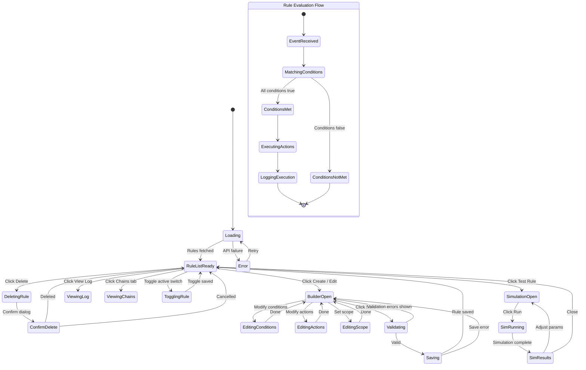

# Page 08 — Rule Engine Page

**Route:** `/dashboard/rules`  
**Access:** Super Admin, Institution Admin  
**Purpose:** Create, manage, test, and monitor dynamic rules that automate waste policy enforcement.

---

## Page Content & Layout

### Sections

| Section | Position | Description |
|---------|----------|-------------|
| Rule Stats Cards | Top | Total Rules, Active, Triggered Today, Chained Rules |
| Rule List Table | Main | All rules with status, priority, trigger count, actions |
| Rule Builder Panel | Side/Modal | Visual IF-THEN builder for creating/editing rules |
| Rule Simulation Panel | Modal | Test rules against historical data |
| Rule Execution Log | Bottom Tab | Recent rule execution audit trail |
| Rule Chain Visualizer | Bottom Tab | Visual graph of chained rules |

### Buttons & Interactive Elements

| Element | ID | Action |
|---------|----|--------|
| Create Rule | `btn-create-rule` | Open rule builder panel |
| Edit Rule | `btn-edit-rule-{id}` | Edit existing rule in builder |
| Delete Rule | `btn-delete-rule-{id}` | Deactivate/delete a rule |
| Toggle Active | `switch-rule-active-{id}` | Enable/disable rule |
| Test Rule | `btn-test-rule-{id}` | Open simulation panel |
| Duplicate Rule | `btn-duplicate-rule-{id}` | Clone rule as new draft |
| View Execution Log | `btn-view-log-{id}` | View executions of this rule |
| Filter by Type | `select-rule-type` | Filter: threshold / frequency / trend / composite |
| Filter by Priority | `select-rule-priority` | Filter: critical / high / medium / low |
| Filter by Status | `select-rule-status` | Filter: active / inactive / draft |
| Save Rule | `btn-save-rule` | Save rule from builder |
| Add Condition | `btn-add-condition` | Add condition row in builder |
| Add Action | `btn-add-action` | Add action to rule |
| Run Simulation | `btn-run-simulation` | Execute simulation with sample data |

---

## Class Diagram

```mermaid
classDiagram
    direction TB

    class RuleEnginePage {
        +String activeTab
        +FilterState filters
        +Rule selectedRule
        +onMount()
        +openBuilder(ruleId?)
        +deleteRule(id)
        +toggleRule(id, active)
        +openSimulation(ruleId)
    }

    class RuleStatsCards {
        +Int totalRules
        +Int activeRules
        +Int triggeredToday
        +Int chainedRules
    }

    class RuleListTable {
        +Rule[] rules
        +SortState sort
        +onEdit(id)
        +onDelete(id)
        +onToggle(id, active)
        +onTest(id)
        +onDuplicate(id)
        +onSort(column)
    }

    class RuleBuilder {
        +Rule rule
        +Boolean isNew
        +ConditionGroup[] conditions
        +Action[] actions
        +Scope scope
        +TimeConstraint timeConstraint
        +addConditionGroup()
        +removeConditionGroup(index)
        +addCondition(groupIndex)
        +removeCondition(groupIndex, condIndex)
        +addAction()
        +removeAction(index)
        +setScope(scope)
        +validate()
        +save()
    }

    class ConditionBuilder {
        +String logicOperator
        +Condition[] conditions
        +FieldOption[] availableFields
        +OperatorOption[] availableOperators
        +setField(field)
        +setOperator(operator)
        +setValue(value)
    }

    class ActionBuilder {
        +ActionType type
        +Map params
        +ActionOption[] availableActions
        +setType(type)
        +setParams(params)
    }

    class RuleSimulationPanel {
        +UUID ruleId
        +DateRange testPeriod
        +SimulationResult result
        +runSimulation()
        +clear()
    }

    class RuleExecutionLog {
        +RuleExecution[] executions
        +UUID filterRuleId
        +fetchExecutions(ruleId?, page)
    }

    class RuleChainVisualizer {
        +ChainNode[] nodes
        +ChainEdge[] edges
        +renderGraph()
        +onNodeClick(ruleId)
    }

    class RuleStore {
        +Rule[] rules
        +RuleStats stats
        +RuleExecution[] executions
        +Boolean isLoading
        +fetchRules(filters)
        +createRule(data)
        +updateRule(id, data)
        +deleteRule(id)
        +toggleRule(id, active)
        +duplicateRule(id)
        +simulateRule(id, period)
        +fetchExecutions(ruleId)
    }

    class RuleApiClient {
        +getRules(filters) PaginatedRules
        +getRule(id) Rule
        +createRule(data) Rule
        +updateRule(id, data) Rule
        +deleteRule(id) void
        +testRule(id, sampleData) TestResult
        +simulateRule(id, period) SimulationResult
        +getRuleExecutions(id) ExecutionList
        +getAvailableFields() FieldOption[]
        +getAvailableOperators() OperatorOption[]
        +getAvailableActions() ActionOption[]
        +getRuleChains() ChainData
    }

    class RuleRouter {
        +GET /api/v1/rules
        +POST /api/v1/rules
        +GET /api/v1/rules/{id}
        +PATCH /api/v1/rules/{id}
        +DELETE /api/v1/rules/{id}
        +POST /api/v1/rules/{id}/test
        +POST /api/v1/rules/{id}/simulate
        +GET /api/v1/rules/{id}/executions
        +GET /api/v1/rules/metadata/fields
        +GET /api/v1/rules/metadata/operators
        +GET /api/v1/rules/metadata/actions
        +GET /api/v1/rules/chains
    }

    class RuleEngineService {
        -RuleRepository ruleRepo
        -EventBus eventBus
        -ConditionMatcher matcher
        -ActionExecutor executor
        +createRule(data) Rule
        +updateRule(id, data) Rule
        +evaluateEvent(event) EvaluationResult[]
        +simulateRule(id, period) SimulationResult
        +getAvailableFields() FieldOption[]
        +getRuleChains() ChainData
    }

    class ConditionMatcher {
        +match(conditions, eventData) Boolean
        +matchNumeric(field, operator, value) Boolean
        +matchString(field, operator, value) Boolean
        +matchTimeWindow(constraint, data) Boolean
        +matchFrequency(count, period, data) Boolean
        +matchTrend(direction, period, data) Boolean
        +matchAggregate(func, field, scope) Number
    }

    class ActionExecutor {
        +execute(actions, context) ActionResult[]
        +generateWarning(params, context) void
        +sendEmail(params, context) void
        +increasePenalty(params, context) void
        +triggerEscalation(params, context) void
        +classifyStudent(params, context) void
        +createAuditLog(params, context) void
    }

    class RuleModel {
        +UUID id
        +String name
        +String description
        +String type
        +String priority
        +Boolean active
        +JSON conditions
        +JSON time_constraints
        +JSON scope
        +JSON actions
        +UUID created_by
        +DateTime created_at
        +DateTime updated_at
        +Int execution_count
    }

    class RuleExecutionModel {
        +UUID id
        +UUID rule_id
        +UUID trigger_event_id
        +String trigger_source
        +JSON matched_conditions
        +JSON executed_actions
        +String result_status
        +DateTime executed_at
    }

    RuleEnginePage --> RuleStatsCards : contains
    RuleEnginePage --> RuleListTable : contains
    RuleEnginePage --> RuleBuilder : opens
    RuleEnginePage --> RuleSimulationPanel : opens
    RuleEnginePage --> RuleExecutionLog : tab
    RuleEnginePage --> RuleChainVisualizer : tab
    RuleEnginePage --> RuleStore : reads state
    RuleBuilder --> ConditionBuilder : contains
    RuleBuilder --> ActionBuilder : contains
    RuleStore --> RuleApiClient : fetches
    RuleApiClient --> RuleRouter : HTTP requests
    RuleRouter --> RuleEngineService : delegates
    RuleEngineService --> ConditionMatcher : evaluates
    RuleEngineService --> ActionExecutor : executes
    RuleEngineService --> RuleModel : queries
    RuleEngineService --> RuleExecutionModel : logs
```

---

## State Diagram



---

## Feature-Action-Controller Map

| # | Feature | User Action | Frontend Controller | API Endpoint | Backend Service | Reaction / Side Effect |
|---|---------|-------------|-------------------|--------------|-----------------|----------------------|
| 1 | **Load Rules** | Page mount | `RuleStore.fetchRules()` | `GET /api/v1/rules` | `RuleEngineService` | Table renders all rules with status, priority, trigger count |
| 2 | **Create Rule** | Clicks Create, builds rule | `RuleBuilder.save()` | `POST /api/v1/rules` | `RuleEngineService.createRule()` | New rule created, immediately starts evaluating if active |
| 3 | **Visual Condition Builder** | Adds IF conditions | `ConditionBuilder` component | `GET /api/v1/rules/metadata/fields` | `RuleEngineService.getAvailableFields()` | Dropdowns populate: field, operator, value with AND/OR grouping |
| 4 | **Action Selection** | Adds THEN actions | `ActionBuilder` component | `GET /api/v1/rules/metadata/actions` | `RuleEngineService` | Select: generate_warning, send_email, increase_penalty, etc. |
| 5 | **Edit Rule** | Clicks Edit | `RuleBuilder` pre-fills | `GET /api/v1/rules/{id}` + `PATCH` | `RuleEngineService.updateRule()` | Rule updated, existing evaluations continue with new logic |
| 6 | **Toggle Rule** | Flips active switch | `RuleStore.toggleRule()` | `PATCH /api/v1/rules/{id}` | `RuleEngineService.updateRule()` | Rule activated/deactivated, audit log entry |
| 7 | **Delete Rule** | Clicks Delete, confirms | `RuleStore.deleteRule()` | `DELETE /api/v1/rules/{id}` | `RuleEngineService` | Rule soft-deleted (deactivated), audit log |
| 8 | **Duplicate Rule** | Clicks Duplicate | `RuleStore.duplicateRule()` | `POST /api/v1/rules` (with copied data) | `RuleEngineService.createRule()` | Clone created as draft with "(Copy)" appended to name |
| 9 | **Test Rule** | Clicks Test, provides sample | `RuleSimulationPanel` | `POST /api/v1/rules/{id}/test` | `RuleEngineService` | Shows which conditions would match, what actions would trigger |
| 10 | **Simulate Rule** | Sets period, clicks Run | `RuleSimulationPanel.runSimulation()` | `POST /api/v1/rules/{id}/simulate` | `RuleEngineService.simulateRule()` | Runs rule against historical data: X students matched, Y actions would fire |
| 11 | **Execution Log** | Clicks Log tab | `RuleExecutionLog.fetchExecutions()` | `GET /api/v1/rules/{id}/executions` | Service method | Table: timestamp, trigger, conditions matched, actions executed, result |
| 12 | **Chain Visualization** | Clicks Chains tab | `RuleChainVisualizer.renderGraph()` | `GET /api/v1/rules/chains` | `RuleEngineService.getRuleChains()` | D3/Mermaid graph: Warning → Escalation → Penalty → Admin Review |
| 13 | **Rule Priority Sorting** | Clicks priority column | `RuleListTable.onSort()` | `GET /api/v1/rules?sort=priority` | Service method | Rules sorted by priority: Critical → High → Medium → Low |
| 14 | **Filter Rules** | Selects filter options | Store re-fetch | `GET /api/v1/rules?type=&priority=&status=` | Service method | Table filtered by type, priority, active status |

---
