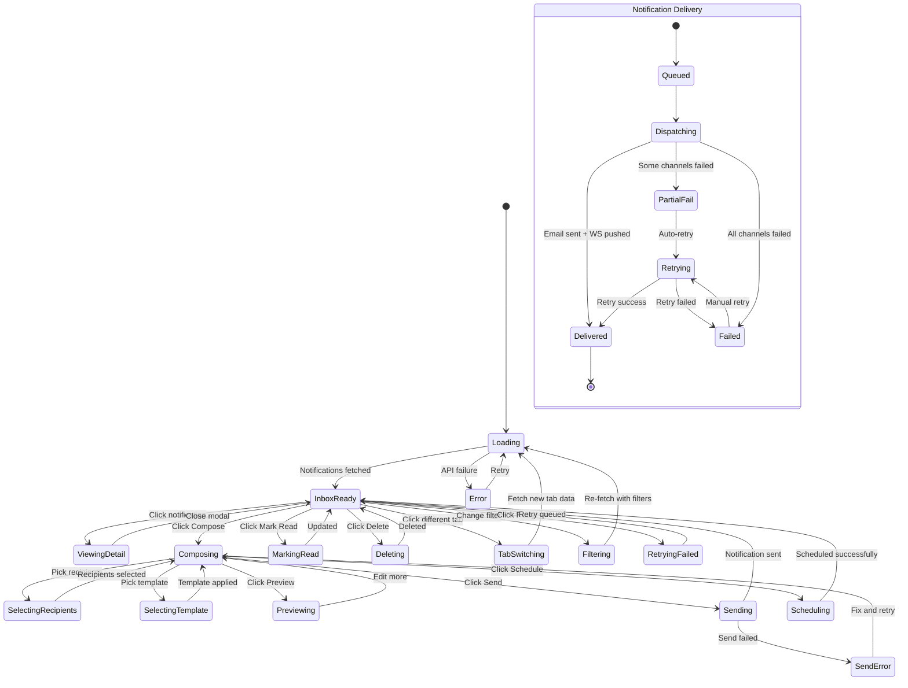

# Page 09 — Notification Center

**Route:** `/dashboard/notifications`  
**Access:** Super Admin, Institution Admin, Mess Admin  
**Purpose:** Central hub for viewing, managing, composing, and tracking all system notifications and custom broadcasts.

---

## Page Content & Layout

### Sections

| Section | Position | Description |
|---------|----------|-------------|
| Notification Stats | Top | Unread count, Sent Today, Failed, Pending |
| Tab Bar | Below Stats | Inbox / Sent / Scheduled / Broadcast |
| Notification List | Main | Chronological list of notifications with type icons |
| Compose Panel | Modal/Side | Create and send custom notifications |
| Notification Detail | Modal | View full notification content and delivery status |

### Buttons & Interactive Elements

| Element | ID | Action |
|---------|----|--------|
| Compose New | `btn-compose-notification` | Open compose panel |
| Mark Read | `btn-mark-read-{id}` | Mark notification as read |
| Mark All Read | `btn-mark-all-read` | Mark all as read |
| Delete | `btn-delete-notification-{id}` | Delete notification |
| Filter by Type | `select-notif-type` | Filter: Warning / Penalty / Alert / System / Custom |
| Filter by Channel | `select-notif-channel` | Filter: Email / Dashboard / Browser Push |
| Retry Failed | `btn-retry-{id}` | Retry failed notification delivery |
| Send Broadcast | `btn-send-broadcast` | Send notification to a group |
| Schedule | `btn-schedule-notification` | Schedule notification for future |
| View Delivery Status | `btn-delivery-{id}` | View detailed delivery tracking |

---

## Class Diagram

```mermaid
classDiagram
    direction TB

    class NotificationCenterPage {
        +String activeTab
        +FilterState filters
        +Int unreadCount
        +onMount()
        +switchTab(tab)
        +openCompose()
        +markAllRead()
    }

    class NotificationStats {
        +Int unread
        +Int sentToday
        +Int failed
        +Int pending
    }

    class NotificationList {
        +Notification[] notifications
        +onRead(id)
        +onDelete(id)
        +onClick(id)
        +onRetry(id)
    }

    class NotificationItem {
        +Notification notification
        +String typeIcon
        +String typeColor
        +Boolean isRead
        +markRead()
        +viewDetail()
    }

    class ComposePanel {
        +String subject
        +String body
        +String[] recipients
        +String channel
        +String templateId
        +DateTime scheduledAt
        +selectRecipients()
        +selectTemplate()
        +preview()
        +send()
        +schedule()
    }

    class RecipientSelector {
        +String selectionType
        +String[] selectedStudents
        +String[] selectedBranches
        +String[] selectedHostels
        +selectAll()
        +selectByBranch(branch)
        +selectByHostel(hostel)
        +selectIndividual(studentIds)
        +getCount()
    }

    class NotificationDetailModal {
        +Notification notification
        +DeliveryStatus[] deliveries
        +render()
    }

    class NotificationStore {
        +Notification[] inbox
        +Notification[] sent
        +Notification[] scheduled
        +Int unreadCount
        +Boolean isLoading
        +fetchNotifications(tab, filters)
        +markRead(id)
        +markAllRead()
        +deleteNotification(id)
        +sendNotification(data)
        +scheduleNotification(data)
        +retryFailed(id)
        +sendBroadcast(data)
    }

    class NotificationApiClient {
        +getNotifications(tab, filters) PaginatedList
        +getNotification(id) NotificationDetail
        +markRead(id) void
        +markAllRead() void
        +deleteNotification(id) void
        +sendNotification(data) Notification
        +scheduleNotification(data) Notification
        +retryNotification(id) void
        +getDeliveryStatus(id) DeliveryStatus[]
        +getTemplates() Template[]
    }

    class NotificationRouter {
        +GET /api/v1/notifications
        +GET /api/v1/notifications/{id}
        +PATCH /api/v1/notifications/{id}/read
        +POST /api/v1/notifications/mark-all-read
        +DELETE /api/v1/notifications/{id}
        +POST /api/v1/notifications
        +POST /api/v1/notifications/broadcast
        +POST /api/v1/notifications/schedule
        +POST /api/v1/notifications/{id}/retry
        +GET /api/v1/notifications/{id}/delivery
    }

    class NotificationService {
        -NotificationRepository repo
        -EmailService emailService
        -WebSocketService wsService
        -TemplateEngine templateEngine
        +listNotifications(tab, filters) PaginatedResult
        +sendNotification(data) Notification
        +sendBroadcast(data) BroadcastResult
        +scheduleNotification(data) Notification
        +retryFailed(id) void
        +markRead(id, userId) void
        +getDeliveryStatus(id) DeliveryStatus[]
    }

    class EmailService {
        -SmtpConfig config
        -TemplateEngine templateEngine
        +sendEmail(to, subject, body) SendResult
        +sendBulk(recipients, template, data) BulkResult
        +renderTemplate(templateId, data) RenderedEmail
    }

    class NotificationModel {
        +UUID id
        +String type
        +String channel
        +String subject
        +String body
        +UUID sender_id
        +String recipient_type
        +JSON recipient_ids
        +String status
        +DateTime scheduled_at
        +DateTime sent_at
        +DateTime created_at
    }

    NotificationCenterPage --> NotificationStats : contains
    NotificationCenterPage --> NotificationList : contains
    NotificationCenterPage --> ComposePanel : opens
    NotificationCenterPage --> NotificationDetailModal : opens
    NotificationCenterPage --> NotificationStore : reads state
    NotificationList --> NotificationItem : renders list
    ComposePanel --> RecipientSelector : contains
    NotificationStore --> NotificationApiClient : fetches
    NotificationApiClient --> NotificationRouter : HTTP requests
    NotificationRouter --> NotificationService : delegates
    NotificationService --> EmailService : sends emails
    NotificationService --> NotificationModel : queries
```

---

## State Diagram



---

## Feature-Action-Controller Map

| # | Feature | User Action | Frontend Controller | API Endpoint | Backend Service | Reaction / Side Effect |
|---|---------|-------------|-------------------|--------------|-----------------|----------------------|
| 1 | **Load Inbox** | Page mount | `NotificationStore.fetchNotifications('inbox')` | `GET /api/v1/notifications?tab=inbox` | `NotificationService.listNotifications()` | Chronological list with unread highlighted |
| 2 | **View Detail** | Clicks notification | `NotificationDetailModal` | `GET /api/v1/notifications/{id}` & `GET /api/v1/notifications/{id}/delivery` | Service method | Full content, delivery status per channel shown |
| 3 | **Mark Read** | Clicks mark read | `NotificationStore.markRead()` | `PATCH /api/v1/notifications/{id}/read` | `NotificationService.markRead()` | Unread badge removed, counter decrements |
| 4 | **Mark All Read** | Clicks mark all read | `NotificationStore.markAllRead()` | `POST /api/v1/notifications/mark-all-read` | Service method | All notifications marked read |
| 5 | **Delete** | Clicks delete | `NotificationStore.deleteNotification()` | `DELETE /api/v1/notifications/{id}` | Service method | Notification removed from list |
| 6 | **Compose** | Opens compose panel | `ComposePanel` | — | — | Form: subject, body, recipients, channel, template |
| 7 | **Select Recipients** | Picks recipients | `RecipientSelector` | `GET /api/v1/students` (for search) | — | Select by: individual, branch, hostel, year, all |
| 8 | **Use Template** | Selects template | `ComposePanel.selectTemplate()` | `GET /api/v1/templates` | `TemplateEngine` | Body pre-fills with template, variables highlighted |
| 9 | **Preview** | Clicks preview | `ComposePanel.preview()` | `POST /api/v1/templates/{id}/preview` | `TemplateEngine.render()` | Shows rendered email preview with variables resolved |
| 10 | **Send** | Clicks Send | `NotificationStore.sendNotification()` | `POST /api/v1/notifications` | `NotificationService.sendNotification()` | Notification dispatched via selected channels |
| 11 | **Broadcast** | Sends to group | `NotificationStore.sendBroadcast()` | `POST /api/v1/notifications/broadcast` | `NotificationService.sendBroadcast()` | Bulk notification to all matching recipients |
| 12 | **Schedule** | Sets date, clicks schedule | `NotificationStore.scheduleNotification()` | `POST /api/v1/notifications/schedule` | Service method | Notification saved for future delivery |
| 13 | **Retry Failed** | Clicks retry on failed | `NotificationStore.retryFailed()` | `POST /api/v1/notifications/{id}/retry` | `NotificationService.retryFailed()` | Failed notification re-queued for delivery |
| 14 | **Filter by Type** | Selects type dropdown | Store re-fetch | `GET /api/v1/notifications?type=warning` | Service method | List filters by notification type |
| 15 | **Sent Tab** | Clicks Sent tab | Store fetches | `GET /api/v1/notifications?tab=sent` | Service method | Shows all sent notifications with delivery status |

---
