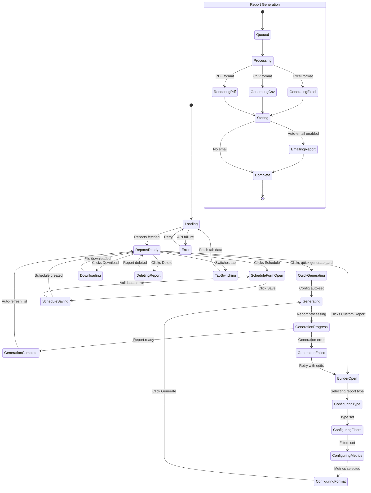

# Page 10 — Reports Page

**Route:** `/dashboard/reports`  
**Access:** Super Admin, Institution Admin, Mess Admin, Analytics Viewer (read-only)  
**Purpose:** Generate, schedule, download, and manage waste reports in PDF, CSV, and Excel formats.

---

## Page Content & Layout

### Sections

| Section | Position | Description |
|---------|----------|-------------|
| Quick Generate Cards | Top | One-click cards: Daily Report, Weekly, Monthly, Custom |
| Generated Reports Table | Main | List of previously generated reports with download links |
| Scheduled Reports | Tab | List of auto-scheduled report jobs |
| Report Builder | Modal | Custom report configuration panel |

### Report Types

| Report Type | Content | Format |
|-------------|---------|--------|
| Daily Waste Report | Today's entries, violations, alerts | PDF, CSV |
| Weekly Summary | Branch comparison, improvement, high-risk | PDF, Excel |
| Monthly Analysis | Sustainability, food optimization, efficiency | PDF, Excel |
| Branch Comparison | Branch vs branch detailed analysis | PDF |
| Student History | Individual student full history | PDF |
| Food Optimization | High waste foods, quantity recommendations | PDF, CSV |
| Custom Report | User-defined filters and metrics | PDF, CSV, Excel |

### Buttons & Interactive Elements

| Element | ID | Action |
|---------|----|--------|
| Generate Daily | `btn-gen-daily` | Quick-generate today's daily report |
| Generate Weekly | `btn-gen-weekly` | Quick-generate weekly summary |
| Generate Monthly | `btn-gen-monthly` | Quick-generate monthly analysis |
| Custom Report | `btn-gen-custom` | Open report builder modal |
| Download | `btn-download-{id}` | Download generated report file |
| Delete Report | `btn-delete-report-{id}` | Delete a generated report |
| Schedule Report | `btn-schedule-report` | Create auto-scheduled report |
| Edit Schedule | `btn-edit-schedule-{id}` | Edit scheduled report job |
| Delete Schedule | `btn-delete-schedule-{id}` | Remove scheduled report |
| Tab: Generated | `tab-generated` | View generated reports |
| Tab: Scheduled | `tab-scheduled` | View scheduled reports |
| Filter by Type | `select-report-type` | Filter reports by type |
| Filter by Date | `input-report-date-range` | Filter by generation date |

---

## Class Diagram

```mermaid
classDiagram
    direction TB

    class ReportsPage {
        +String activeTab
        +FilterState filters
        +onMount()
        +quickGenerate(type)
        +openBuilder()
        +openScheduleForm()
    }

    class QuickGenerateCards {
        +onGenerateDaily()
        +onGenerateWeekly()
        +onGenerateMonthly()
        +onGenerateCustom()
    }

    class GeneratedReportsTable {
        +Report[] reports
        +onDownload(id)
        +onDelete(id)
        +onView(id)
    }

    class ScheduledReportsTable {
        +ReportSchedule[] schedules
        +onEdit(id)
        +onDelete(id)
        +onToggle(id, active)
    }

    class ReportBuilderModal {
        +String reportType
        +FilterState filters
        +String[] selectedMetrics
        +String format
        +selectType(type)
        +setFilters(filters)
        +selectMetrics(metrics)
        +setFormat(format)
        +preview()
        +generate()
    }

    class ScheduleFormModal {
        +String reportType
        +String frequency
        +String dayOfWeek
        +String timeOfDay
        +String[] emailRecipients
        +Boolean autoEmail
        +save()
    }

    class ReportsStore {
        +Report[] generatedReports
        +ReportSchedule[] schedules
        +Boolean isGenerating
        +Boolean isLoading
        +fetchReports(filters)
        +generateReport(config)
        +downloadReport(id)
        +deleteReport(id)
        +fetchSchedules()
        +createSchedule(data)
        +updateSchedule(id, data)
        +deleteSchedule(id)
    }

    class ReportsApiClient {
        +getReports(filters) PaginatedReports
        +generateReport(config) GenerateResult
        +downloadReport(id) Blob
        +deleteReport(id) void
        +getSchedules() ScheduleList
        +createSchedule(data) ReportSchedule
        +updateSchedule(id, data) ReportSchedule
        +deleteSchedule(id) void
    }

    class ReportRouter {
        +GET /api/v1/reports
        +POST /api/v1/reports/generate
        +GET /api/v1/reports/{id}/download
        +DELETE /api/v1/reports/{id}
        +GET /api/v1/reports/schedules
        +POST /api/v1/reports/schedules
        +PATCH /api/v1/reports/schedules/{id}
        +DELETE /api/v1/reports/schedules/{id}
    }

    class ReportService {
        -ReportRepository repo
        -AnalyticsService analyticsService
        -PdfGenerator pdfGen
        -CsvGenerator csvGen
        -ExcelGenerator excelGen
        -EmailService emailService
        +generateReport(config) Report
        +generateDailyReport() Report
        +generateWeeklyReport() Report
        +generateMonthlyReport() Report
        +generateCustomReport(config) Report
        +getReportFile(id) FileBytes
        +scheduleReport(data) ReportSchedule
        +executeScheduledReports() void
    }

    class PdfGenerator {
        +generateDailyPdf(data) bytes
        +generateWeeklyPdf(data) bytes
        +generateStudentPdf(data) bytes
        +renderTemplate(template, data) bytes
    }

    class ReportModel {
        +UUID id
        +String type
        +String format
        +String file_path
        +Long file_size
        +JSON config
        +UUID generated_by
        +String status
        +DateTime generated_at
    }

    class ReportScheduleModel {
        +UUID id
        +String report_type
        +String frequency
        +String day_of_week
        +String time_of_day
        +JSON email_recipients
        +Boolean active
        +DateTime last_run
        +DateTime next_run
    }

    ReportsPage --> QuickGenerateCards : contains
    ReportsPage --> GeneratedReportsTable : tab
    ReportsPage --> ScheduledReportsTable : tab
    ReportsPage --> ReportBuilderModal : opens
    ReportsPage --> ScheduleFormModal : opens
    ReportsPage --> ReportsStore : reads state
    ReportsStore --> ReportsApiClient : fetches
    ReportsApiClient --> ReportRouter : HTTP requests
    ReportRouter --> ReportService : delegates
    ReportService --> PdfGenerator : generates PDF
    ReportService --> ReportModel : stores
    ReportService --> ReportScheduleModel : manages
```

---

## State Diagram



---

## Feature-Action-Controller Map

| # | Feature | User Action | Frontend Controller | API Endpoint | Backend Service | Reaction / Side Effect |
|---|---------|-------------|-------------------|--------------|-----------------|----------------------|
| 1 | **Load Reports** | Page mount | `ReportsStore.fetchReports()` | `GET /api/v1/reports` | `ReportService` | Table renders with generated reports list |
| 2 | **Quick Daily** | Clicks Daily card | `ReportsStore.generateReport({type:'daily'})` | `POST /api/v1/reports/generate` | `ReportService.generateDailyReport()` | Daily PDF generates, appears in table when ready |
| 3 | **Quick Weekly** | Clicks Weekly card | `ReportsStore.generateReport({type:'weekly'})` | `POST /api/v1/reports/generate` | `ReportService.generateWeeklyReport()` | Weekly summary PDF/Excel generates |
| 4 | **Quick Monthly** | Clicks Monthly card | `ReportsStore.generateReport({type:'monthly'})` | `POST /api/v1/reports/generate` | `ReportService.generateMonthlyReport()` | Monthly analysis generates |
| 5 | **Custom Report** | Configures in builder | `ReportBuilderModal.generate()` | `POST /api/v1/reports/generate` | `ReportService.generateCustomReport()` | Custom report with selected filters, metrics, format |
| 6 | **Download** | Clicks download icon | `ReportsStore.downloadReport()` | `GET /api/v1/reports/{id}/download` | `ReportService.getReportFile()` | Browser downloads PDF/CSV/Excel file |
| 7 | **Delete Report** | Clicks delete | `ReportsStore.deleteReport()` | `DELETE /api/v1/reports/{id}` | Service method | Report file deleted, entry removed |
| 8 | **Schedule Report** | Configures schedule form | `ReportsStore.createSchedule()` | `POST /api/v1/reports/schedules` | `ReportService.scheduleReport()` | Cron job created: e.g., "Weekly every Monday at 8 AM" |
| 9 | **Edit Schedule** | Clicks edit schedule | `ScheduleFormModal` | `PATCH /api/v1/reports/schedules/{id}` | Service method | Schedule updated |
| 10 | **Toggle Schedule** | Flips active switch | Store method | `PATCH /api/v1/reports/schedules/{id}` | Service method | Schedule enabled/disabled |
| 11 | **Scheduled Auto-Run** | Automatic (cron) | — | — (background task) | `ReportService.executeScheduledReports()` | Report auto-generates, optionally emailed to recipients |
| 12 | **Filter Reports** | Selects type/date filter | Store re-fetch | `GET /api/v1/reports?type=&date_from=` | Service method | Table filters by report type and date range |
| 13 | **Generation Progress** | Automatic (polling/WS) | Progress indicator | `WS /ws/dashboard` or polling | — | Shows "Generating..." → "Ready" with progress bar |

---
