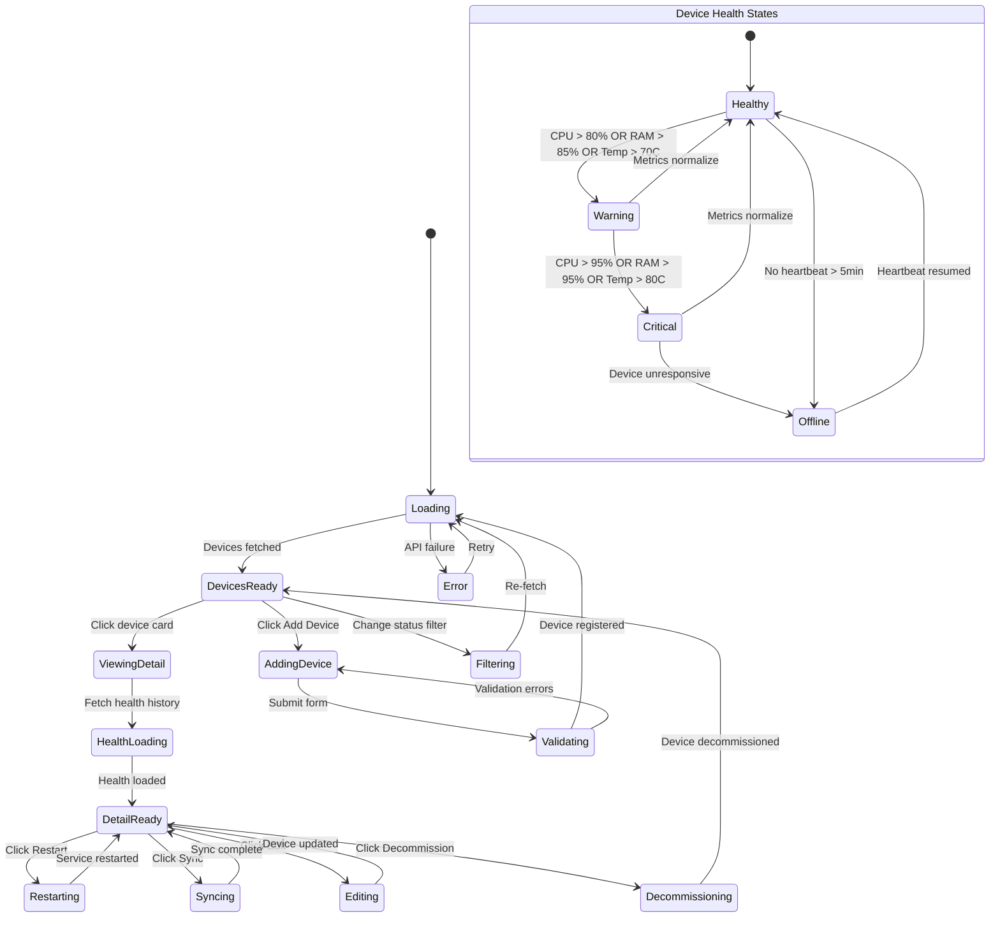

# Page 11 — Devices Page

**Route:** `/dashboard/devices`  
**Access:** Super Admin, Institution Admin, Mess Admin (own devices only)  
**Purpose:** Manage Raspberry Pi devices — identity, health monitoring, configuration, and operational status.

---

## Page Content & Layout

### Sections

| Section | Position | Description |
|---------|----------|-------------|
| Device Overview Cards | Top | Total Devices, Online, Offline, Warning |
| Device Grid/List | Main | Grid or table view of all devices |
| Device Detail Panel | Side/Modal | Full device info + health metrics |
| Health History Charts | In Detail | CPU, RAM, Temp over time graphs |

### Buttons & Interactive Elements

| Element | ID | Action |
|---------|----|--------|
| Add Device | `btn-add-device` | Register new Raspberry Pi |
| View Toggle | `btn-view-grid` / `btn-view-list` | Switch grid ↔ list view |
| Device Card | `card-device-{id}` | Open device detail |
| Restart Service | `btn-restart-{id}` | Restart services on device |
| Sync Now | `btn-sync-{id}` | Trigger manual data sync |
| Edit Device | `btn-edit-device-{id}` | Edit device identity info |
| Decommission | `btn-decommission-{id}` | Mark device as inactive |
| Refresh Health | `btn-refresh-health` | Force-refresh all device health |
| Filter by Status | `select-device-status` | Online / Offline / Warning |

---

## Class Diagram

```mermaid
classDiagram
    direction TB

    class DevicesPage {
        +String viewMode
        +FilterState filters
        +Device selectedDevice
        +onMount()
        +toggleView()
        +openDetail(deviceId)
        +addDevice()
    }

    class DeviceOverviewCards {
        +Int total
        +Int online
        +Int offline
        +Int warning
    }

    class DeviceGrid {
        +Device[] devices
        +onDeviceClick(id)
    }

    class DeviceCard {
        +Device device
        +String statusColor
        +Float cpuUsage
        +Float ramUsage
        +Float temperature
        +String lastSync
        +getStatusIcon()
    }

    class DeviceDetailPanel {
        +Device device
        +HealthHistory health
        +onRestart()
        +onSync()
        +onEdit()
        +onDecommission()
    }

    class DeviceHealthCharts {
        +HealthPoint[] cpuHistory
        +HealthPoint[] ramHistory
        +HealthPoint[] tempHistory
        +renderCpuChart()
        +renderRamChart()
        +renderTempChart()
    }

    class AddDeviceModal {
        +DeviceFormData form
        +validate()
        +submit()
    }

    class DevicesStore {
        +Device[] devices
        +DeviceStats stats
        +Device selectedDevice
        +HealthHistory health
        +Boolean isLoading
        +fetchDevices(filters)
        +fetchDeviceDetail(id)
        +fetchHealthHistory(id)
        +registerDevice(data)
        +updateDevice(id, data)
        +restartService(id)
        +triggerSync(id)
        +decommission(id)
    }

    class DevicesApiClient {
        +getDevices(filters) DeviceList
        +getDevice(id) Device
        +getDeviceHealth(id) HealthData
        +getHealthHistory(id, period) HealthHistory
        +registerDevice(data) Device
        +updateDevice(id, data) Device
        +restartService(id) void
        +triggerSync(id) SyncResult
        +decommission(id) void
    }

    class DeviceRouter {
        +GET /api/v1/devices
        +POST /api/v1/devices
        +GET /api/v1/devices/{id}
        +PATCH /api/v1/devices/{id}
        +GET /api/v1/devices/{id}/health
        +GET /api/v1/devices/{id}/health/history
        +POST /api/v1/devices/{id}/restart
        +POST /api/v1/devices/{id}/sync
        +POST /api/v1/devices/{id}/decommission
    }

    class DeviceService {
        -DeviceRepository repo
        -HealthMonitor healthMonitor
        -SyncManager syncManager
        +listDevices(filters) DeviceList
        +registerDevice(data) Device
        +getDeviceHealth(id) HealthData
        +getHealthHistory(id, period) HealthHistory
        +restartService(id) void
        +triggerSync(id) SyncResult
        +decommission(id) void
        +updateHeartbeat(id, healthData) void
    }

    class DeviceModel {
        +UUID id
        +String device_serial
        +String edge_node_name
        +String institution_name
        +String campus_name
        +String mess_name
        +String hostel_name
        +String hostel_block
        +Int floor_number
        +String status
        +String ip_address
        +String mac_address
        +String firmware_version
        +DateTime last_heartbeat
        +DateTime last_sync
        +DateTime active_since
    }

    class DeviceHealthModel {
        +UUID id
        +UUID device_id
        +Float cpu_percent
        +Float ram_percent
        +Float temperature
        +Float storage_percent
        +Boolean connectivity
        +DateTime recorded_at
    }

    DevicesPage --> DeviceOverviewCards : contains
    DevicesPage --> DeviceGrid : contains
    DevicesPage --> DeviceDetailPanel : opens
    DevicesPage --> AddDeviceModal : opens
    DevicesPage --> DevicesStore : reads state
    DeviceGrid --> DeviceCard : renders list
    DeviceDetailPanel --> DeviceHealthCharts : contains
    DevicesStore --> DevicesApiClient : fetches
    DevicesApiClient --> DeviceRouter : HTTP requests
    DeviceRouter --> DeviceService : delegates
    DeviceService --> DeviceModel : queries
    DeviceService --> DeviceHealthModel : queries
```

---

## State Diagram



---

## Feature-Action-Controller Map

| # | Feature | User Action | Frontend Controller | API Endpoint | Backend Service | Reaction / Side Effect |
|---|---------|-------------|-------------------|--------------|-----------------|----------------------|
| 1 | **Load Devices** | Page mount | `DevicesStore.fetchDevices()` | `GET /api/v1/devices` | `DeviceService.listDevices()` | Grid/table renders all registered devices |
| 2 | **Device Status** | Visual (auto) | `DeviceCard.getStatusIcon()` | — | — | Green=Online, Yellow=Warning, Red=Offline |
| 3 | **View Detail** | Clicks device card | `DevicesStore.fetchDeviceDetail()` | `GET /api/v1/devices/{id}` + `health` + `health/history` | `DeviceService` | Side panel with full identity, health charts |
| 4 | **Health Charts** | In detail view | `DeviceHealthCharts` | `GET /api/v1/devices/{id}/health/history` | `DeviceService.getHealthHistory()` | Line charts: CPU%, RAM%, Temp over last 24h |
| 5 | **Register Device** | Fills form, submits | `AddDeviceModal.submit()` | `POST /api/v1/devices` | `DeviceService.registerDevice()` | New device registered with identity info |
| 6 | **Edit Device** | Modifies identity info | `DeviceDetailPanel.onEdit()` | `PATCH /api/v1/devices/{id}` | `DeviceService.updateDevice()` | Device identity updated (mess name, hostel, etc.) |
| 7 | **Restart Service** | Clicks Restart | `DeviceDetailPanel.onRestart()` | `POST /api/v1/devices/{id}/restart` | `DeviceService.restartService()` | FastAPI/ML services restart on Pi, confirm toast |
| 8 | **Manual Sync** | Clicks Sync Now | `DeviceDetailPanel.onSync()` | `POST /api/v1/devices/{id}/sync` | `DeviceService.triggerSync()` | Data sync triggered, result shown (synced X entries) |
| 9 | **Decommission** | Clicks Decommission | `DevicesStore.decommission()` | `POST /api/v1/devices/{id}/decommission` | `DeviceService.decommission()` | Device marked inactive, removed from active grid |
| 10 | **Auto Health Updates** | WebSocket | `MonitoringStore` | `WS /ws/monitoring` → `device_status` | `DeviceService.updateHeartbeat()` | Device cards update live: CPU, RAM, temp, status |
| 11 | **Filter by Status** | Selects dropdown | Store re-fetch | `GET /api/v1/devices?status=offline` | Service method | Grid shows only devices matching status |
| 12 | **View Toggle** | Clicks grid/list | `DevicesPage.toggleView()` | — | — | Switch between card grid and detailed table view |

---
