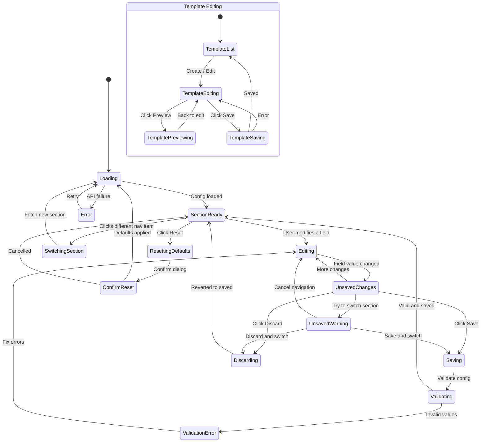

# Page 12 — Configuration Dashboard

**Route:** `/dashboard/config/*` (sub-routes: `/institution`, `/device-identity`, `/thresholds`, `/rules`, `/templates`, `/permissions`, `/system`)  
**Access:** Super Admin, Institution Admin, Mess Admin (limited)  
**Purpose:** Centralized configuration for institution, policies, thresholds, email templates, roles, and system settings.

---

## Page Content & Layout

### Sub-Pages

| Sub-Page | Route | Description |
|----------|-------|-------------|
| Institution Settings | `/config/institution` | Institution name, campus, contact info |
| Device Identity | `/config/device-identity` | Raspberry Pi identity configuration |
| Thresholds | `/config/thresholds` | Waste, warning, penalty threshold values |
| Rules Config | `/config/rules` | Quick rule enable/disable (links to Rule Engine) |
| Email Templates | `/config/templates` | CRUD for email templates with preview |
| Permissions | `/config/permissions` | Role definitions and access control |
| System Policies | `/config/system` | Sync, backup, retention, offline policies |

### Shared Components

| Component | Type | Description |
|-----------|------|-------------|
| ConfigSidebar | Navigation | Left sidebar with config categories |
| SaveBar | Sticky Footer | Shows unsaved changes with Save/Discard buttons |
| ConfigHistory | Panel | Audit trail of recent config changes |

### Buttons & Interactive Elements

| Element | ID | Action |
|---------|----|--------|
| Save Changes | `btn-save-config` | Save current config section |
| Discard Changes | `btn-discard-config` | Revert to last saved values |
| Reset to Default | `btn-reset-defaults` | Reset section to factory defaults |
| Add Meal Timing | `btn-add-meal` | Add new meal session timing |
| Add Branch | `btn-add-branch` | Add new branch mapping |
| Add Hostel | `btn-add-hostel` | Add new hostel mapping |
| Create Template | `btn-create-template` | Create new email template |
| Preview Template | `btn-preview-template-{id}` | Preview rendered template |
| Edit Template | `btn-edit-template-{id}` | Edit template content |
| Delete Template | `btn-delete-template-{id}` | Delete email template |
| Add Role | `btn-add-role` | Create new role |
| Edit Permissions | `btn-edit-perms-{role}` | Edit role permissions |
| Config Nav Item | `nav-config-{section}` | Navigate between config sections |

---

## Class Diagram

```mermaid
classDiagram
    direction TB

    class ConfigDashboard {
        +String activeSection
        +Boolean hasUnsavedChanges
        +onMount()
        +switchSection(section)
        +save()
        +discard()
        +resetDefaults()
    }

    class InstitutionSettings {
        +InstitutionConfig config
        +String institutionName
        +String institutionCode
        +String campusName
        +String adminContact
        +String supportContact
        +updateField(field, value)
    }

    class DeviceIdentityConfig {
        +DeviceIdentity identity
        +String messName
        +String hostelName
        +String hostelBlock
        +Int floorNumber
        +String wing
        +Int capacity
        +updateField(field, value)
    }

    class ThresholdConfig {
        +Float wasteThreshold
        +Float warningThreshold
        +Float penaltyThreshold
        +Float improvementTarget
        +Int resetDurationDays
        +Int warningCountForPenalty
        +updateThreshold(name, value)
    }

    class MealTimingConfig {
        +MealTiming[] meals
        +addMeal()
        +removeMeal(index)
        +updateMeal(index, data)
    }

    class BranchMappingConfig {
        +Branch[] branches
        +addBranch()
        +removeBranch(id)
        +updateBranch(id, data)
    }

    class TemplateManager {
        +EmailTemplate[] templates
        +EmailTemplate selectedTemplate
        +createTemplate()
        +editTemplate(id)
        +deleteTemplate(id)
        +previewTemplate(id)
    }

    class TemplateEditor {
        +String name
        +String subject
        +String body
        +String[] variables
        +insertVariable(variable)
        +preview()
        +save()
    }

    class PermissionsManager {
        +Role[] roles
        +Permission[][] permissionMatrix
        +addRole()
        +editRole(roleId)
        +updatePermission(roleId, resource, action)
    }

    class SystemPolicies {
        +Int syncFrequencyMinutes
        +String offlineHandling
        +Int backupIntervalHours
        +Int dataRetentionDays
        +Int logRetentionDays
        +updatePolicy(name, value)
    }

    class ConfigStore {
        +InstitutionConfig institution
        +DeviceIdentity device
        +ThresholdValues thresholds
        +MealTiming[] meals
        +Branch[] branches
        +Hostel[] hostels
        +EmailTemplate[] templates
        +Role[] roles
        +SystemPolicy policies
        +Boolean hasChanges
        +Boolean isLoading
        +fetchConfig(section)
        +updateConfig(section, data)
        +resetDefaults(section)
        +fetchTemplates()
        +saveTemplate(data)
        +deleteTemplate(id)
        +fetchRoles()
        +updateRole(id, data)
    }

    class ConfigApiClient {
        +getInstitutionConfig() InstitutionConfig
        +updateInstitutionConfig(data) void
        +getDeviceIdentity() DeviceIdentity
        +updateDeviceIdentity(data) void
        +getThresholds() ThresholdValues
        +updateThresholds(data) void
        +getMealTimings() MealTiming[]
        +updateMealTimings(data) void
        +getBranches() Branch[]
        +updateBranches(data) void
        +getTemplates() EmailTemplate[]
        +createTemplate(data) EmailTemplate
        +updateTemplate(id, data) void
        +deleteTemplate(id) void
        +previewTemplate(id, sampleData) RenderedHtml
        +getRoles() Role[]
        +updateRole(id, permissions) void
        +getSystemPolicies() SystemPolicy
        +updateSystemPolicies(data) void
        +resetDefaults(section) DefaultValues
    }

    class ConfigRouter {
        +GET /api/v1/config/institution
        +PATCH /api/v1/config/institution
        +GET /api/v1/config/device
        +PATCH /api/v1/config/device
        +GET /api/v1/config/thresholds
        +PATCH /api/v1/config/thresholds
        +GET /api/v1/config/meals
        +PUT /api/v1/config/meals
        +GET /api/v1/config/branches
        +PUT /api/v1/config/branches
        +GET /api/v1/config/system
        +PATCH /api/v1/config/system
        +POST /api/v1/config/reset/{section}
    }

    class TemplateRouter {
        +GET /api/v1/templates
        +POST /api/v1/templates
        +GET /api/v1/templates/{id}
        +PATCH /api/v1/templates/{id}
        +DELETE /api/v1/templates/{id}
        +POST /api/v1/templates/{id}/preview
    }

    class ConfigService {
        -ConfigRepository repo
        -AuditService auditService
        +getConfig(section) ConfigData
        +updateConfig(section, data, userId) void
        +resetDefaults(section) DefaultValues
        +validateConfig(section, data) ValidationResult
    }

    class EmailTemplateModel {
        +UUID id
        +String name
        +String type
        +String subject
        +String body_html
        +String[] variables
        +Boolean is_default
        +UUID created_by
        +DateTime created_at
        +DateTime updated_at
    }

    class RoleModel {
        +UUID id
        +String name
        +String description
        +JSON permissions
        +Boolean is_system
        +DateTime created_at
    }

    ConfigDashboard --> InstitutionSettings : section
    ConfigDashboard --> DeviceIdentityConfig : section
    ConfigDashboard --> ThresholdConfig : section
    ConfigDashboard --> MealTimingConfig : section
    ConfigDashboard --> BranchMappingConfig : section
    ConfigDashboard --> TemplateManager : section
    ConfigDashboard --> PermissionsManager : section
    ConfigDashboard --> SystemPolicies : section
    ConfigDashboard --> ConfigStore : reads state
    TemplateManager --> TemplateEditor : opens
    ConfigStore --> ConfigApiClient : fetches
    ConfigApiClient --> ConfigRouter : HTTP requests
    ConfigApiClient --> TemplateRouter : HTTP requests
    ConfigRouter --> ConfigService : delegates
    ConfigService --> EmailTemplateModel : queries
    ConfigService --> RoleModel : queries
```

---

## State Diagram



---

## Feature-Action-Controller Map

| # | Feature | User Action | Frontend Controller | API Endpoint | Backend Service | Reaction / Side Effect |
|---|---------|-------------|-------------------|--------------|-----------------|----------------------|
| 1 | **Load Config** | Page mount / section switch | `ConfigStore.fetchConfig(section)` | `GET /api/v1/config/{section}` | `ConfigService.getConfig()` | Form fields populate with current values |
| 2 | **Edit Institution** | Modifies institution fields | `InstitutionSettings.updateField()` | — (local state) | — | Save bar appears with unsaved changes indicator |
| 3 | **Save Config** | Clicks Save | `ConfigStore.updateConfig()` | `PATCH /api/v1/config/{section}` | `ConfigService.updateConfig()` | Config saved, audit log entry, success toast |
| 4 | **Discard Changes** | Clicks Discard | `ConfigDashboard.discard()` | — | — | Fields revert to last saved values |
| 5 | **Reset Defaults** | Clicks Reset, confirms | `ConfigStore.resetDefaults()` | `POST /api/v1/config/reset/{section}` | `ConfigService.resetDefaults()` | Section reset to factory defaults |
| 6 | **Edit Thresholds** | Changes waste/warning/penalty values | `ThresholdConfig.updateThreshold()` | `PATCH /api/v1/config/thresholds` | ConfigService | Thresholds updated, rule engine uses new values |
| 7 | **Manage Meal Timings** | Add/edit/remove meals | `MealTimingConfig` | `PUT /api/v1/config/meals` | ConfigService | Meal sessions updated (e.g., Breakfast 7-9 AM) |
| 8 | **Manage Branches** | Add/edit/remove branches | `BranchMappingConfig` | `PUT /api/v1/config/branches` | ConfigService | Branch list updated for filters and analytics |
| 9 | **Create Template** | Clicks Create, fills editor | `TemplateEditor.save()` | `POST /api/v1/templates` | ConfigService | New email template saved with variables |
| 10 | **Edit Template** | Modifies template content | `TemplateEditor.save()` | `PATCH /api/v1/templates/{id}` | ConfigService | Template updated, future emails use new version |
| 11 | **Preview Template** | Clicks Preview | `TemplateEditor.preview()` | `POST /api/v1/templates/{id}/preview` | `TemplateEngine.render()` | Rendered HTML preview with sample data |
| 12 | **Delete Template** | Clicks Delete, confirms | `TemplateManager.deleteTemplate()` | `DELETE /api/v1/templates/{id}` | ConfigService | Template removed (only non-default) |
| 13 | **Edit Permissions** | Toggles permission checkboxes | `PermissionsManager.updatePermission()` | `PATCH /api/v1/roles/{id}` | ConfigService | Role permissions updated, takes effect on next request |
| 14 | **System Policies** | Changes sync/backup/retention | `SystemPolicies.updatePolicy()` | `PATCH /api/v1/config/system` | ConfigService | System behavior updated (e.g., sync every 5 min) |
| 15 | **Unsaved Warning** | Tries to navigate with unsaved | `ConfigDashboard` guard | — | — | Modal: "Save changes?", Save / Discard / Cancel |
| 16 | **Audit Trail** | Views config history | `ConfigHistory` panel | `GET /api/v1/audit?resource=config` | `AuditService` | Shows who changed what config, when |

---
