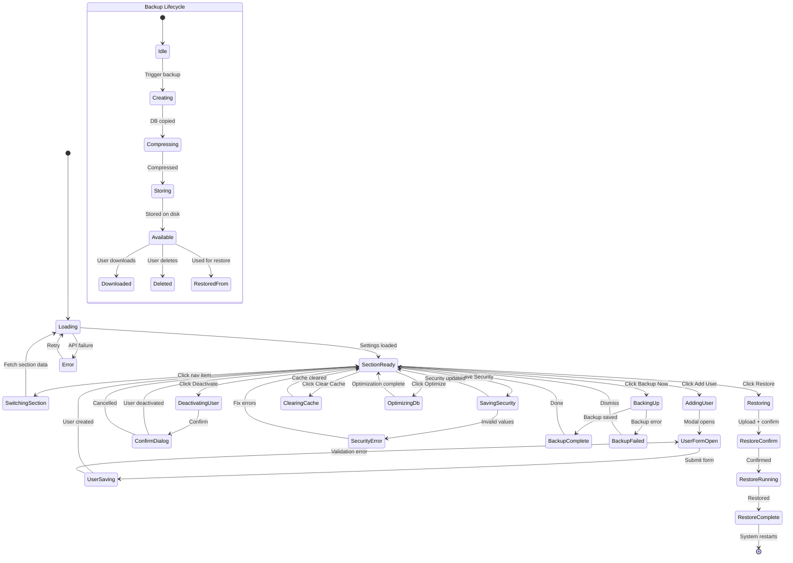

# Page 13 — Settings Page

**Route:** `/dashboard/settings`  
**Access:** Super Admin, Institution Admin (limited)  
**Purpose:** System-level settings for the platform — user management, security, backup, appearance, and maintenance.

---

## Page Content & Layout

### Sections

| Section | Position | Description |
|---------|----------|-------------|
| Settings Navigation | Left Sidebar | Category list: Users, Security, Backup, Appearance, Maintenance |
| User Management | Main (Section 1) | Admin user CRUD, role assignment |
| Security Settings | Main (Section 2) | JWT config, password policy, session management |
| Backup & Recovery | Main (Section 3) | Database backup, restore, export all data |
| Appearance | Main (Section 4) | Theme, branding, logo upload |
| Maintenance | Main (Section 5) | Cache clear, DB optimize, system info |

### Buttons & Interactive Elements

| Element | ID | Action |
|---------|----|--------|
| Add User | `btn-add-user` | Create new admin/operator user |
| Edit User | `btn-edit-user-{id}` | Edit user details and role |
| Deactivate User | `btn-deactivate-user-{id}` | Disable user account |
| Reset Password | `btn-reset-pwd-{id}` | Force password reset for user |
| Save Security | `btn-save-security` | Save security settings |
| Backup Now | `btn-backup-now` | Trigger immediate database backup |
| Restore Backup | `btn-restore-backup` | Restore from a backup file |
| Download Backup | `btn-download-backup-{id}` | Download backup file |
| Upload Logo | `btn-upload-logo` | Upload institution logo |
| Toggle Theme | `btn-toggle-theme` | Switch light/dark theme |
| Clear Cache | `btn-clear-cache` | Clear Redis cache |
| Optimize DB | `btn-optimize-db` | Run SQLite VACUUM/optimize |
| Export All Data | `btn-export-all` | Full data export as ZIP |

---

## Class Diagram

```mermaid
classDiagram
    direction TB

    class SettingsPage {
        +String activeSection
        +onMount()
        +switchSection(section)
    }

    class UserManagement {
        +User[] users
        +addUser()
        +editUser(id)
        +deactivateUser(id)
        +resetPassword(id)
    }

    class AddUserModal {
        +String name
        +String email
        +String role
        +String tempPassword
        +validate()
        +submit()
    }

    class SecuritySettings {
        +Int accessTokenExpiryMin
        +Int refreshTokenExpiryDays
        +Int minPasswordLength
        +Boolean requireUppercase
        +Boolean requireNumbers
        +Int maxLoginAttempts
        +Int lockoutDurationMin
        +Int sessionTimeoutMin
        +save()
    }

    class BackupRecovery {
        +Backup[] backups
        +Boolean isBackingUp
        +triggerBackup()
        +downloadBackup(id)
        +restoreBackup(file)
        +deleteBackup(id)
    }

    class AppearanceSettings {
        +String theme
        +String logoUrl
        +String primaryColor
        +String institutionDisplayName
        +uploadLogo(file)
        +setTheme(theme)
        +save()
    }

    class MaintenancePanel {
        +SystemInfo info
        +clearCache()
        +optimizeDb()
        +exportAllData()
        +getSystemInfo()
    }

    class SettingsStore {
        +User[] users
        +SecurityConfig security
        +Backup[] backups
        +AppearanceConfig appearance
        +SystemInfo systemInfo
        +Boolean isLoading
        +fetchUsers()
        +createUser(data)
        +updateUser(id, data)
        +deactivateUser(id)
        +fetchSecurityConfig()
        +updateSecurityConfig(data)
        +fetchBackups()
        +triggerBackup()
        +restoreBackup(file)
        +fetchAppearance()
        +updateAppearance(data)
        +clearCache()
        +optimizeDb()
        +exportAll()
    }

    class SettingsApiClient {
        +getUsers() UserList
        +createUser(data) User
        +updateUser(id, data) User
        +deactivateUser(id) void
        +resetUserPassword(id) TempPassword
        +getSecurityConfig() SecurityConfig
        +updateSecurityConfig(data) void
        +getBackups() BackupList
        +triggerBackup() Backup
        +downloadBackup(id) Blob
        +restoreBackup(file) RestoreResult
        +getAppearance() AppearanceConfig
        +updateAppearance(data) void
        +uploadLogo(file) LogoUrl
        +clearCache() CacheResult
        +optimizeDb() OptimizeResult
        +getSystemInfo() SystemInfo
        +exportAll() Blob
    }

    class SettingsRouter {
        +GET /api/v1/settings/users
        +POST /api/v1/settings/users
        +PATCH /api/v1/settings/users/{id}
        +POST /api/v1/settings/users/{id}/deactivate
        +POST /api/v1/settings/users/{id}/reset-password
        +GET /api/v1/settings/security
        +PATCH /api/v1/settings/security
        +GET /api/v1/settings/backups
        +POST /api/v1/settings/backups
        +GET /api/v1/settings/backups/{id}/download
        +POST /api/v1/settings/backups/restore
        +GET /api/v1/settings/appearance
        +PATCH /api/v1/settings/appearance
        +POST /api/v1/settings/appearance/logo
        +POST /api/v1/settings/maintenance/clear-cache
        +POST /api/v1/settings/maintenance/optimize-db
        +GET /api/v1/settings/maintenance/system-info
        +GET /api/v1/settings/maintenance/export-all
    }

    class SettingsService {
        -UserRepository userRepo
        -BackupManager backupMgr
        -CacheManager cacheMgr
        -DatabaseOptimizer dbOptimizer
        -AuditService auditService
        +listUsers() UserList
        +createUser(data) User
        +deactivateUser(id) void
        +resetUserPassword(id) TempPassword
        +getSecurityConfig() SecurityConfig
        +updateSecurityConfig(data) void
        +triggerBackup() Backup
        +restoreBackup(file) RestoreResult
        +clearCache() CacheResult
        +optimizeDatabase() OptimizeResult
        +getSystemInfo() SystemInfo
        +exportAllData() FileBytes
    }

    class BackupModel {
        +UUID id
        +String filename
        +Long file_size
        +String backup_type
        +String status
        +UUID triggered_by
        +DateTime created_at
    }

    SettingsPage --> UserManagement : section
    SettingsPage --> SecuritySettings : section
    SettingsPage --> BackupRecovery : section
    SettingsPage --> AppearanceSettings : section
    SettingsPage --> MaintenancePanel : section
    SettingsPage --> SettingsStore : reads state
    UserManagement --> AddUserModal : opens
    SettingsStore --> SettingsApiClient : fetches
    SettingsApiClient --> SettingsRouter : HTTP requests
    SettingsRouter --> SettingsService : delegates
    SettingsService --> BackupModel : manages
```

---

## State Diagram



---

## Feature-Action-Controller Map

| # | Feature | User Action | Frontend Controller | API Endpoint | Backend Service | Reaction / Side Effect |
|---|---------|-------------|-------------------|--------------|-----------------|----------------------|
| 1 | **List Users** | Views user management | `SettingsStore.fetchUsers()` | `GET /api/v1/settings/users` | `SettingsService.listUsers()` | Table of admin/operator accounts with roles |
| 2 | **Add User** | Fills form, submits | `AddUserModal.submit()` | `POST /api/v1/settings/users` | `SettingsService.createUser()` | User created with temp password, email sent |
| 3 | **Edit User** | Modifies user info | Modal submit | `PATCH /api/v1/settings/users/{id}` | Service method | User details/role updated |
| 4 | **Deactivate User** | Clicks deactivate, confirms | Confirm dialog | `POST /api/v1/settings/users/{id}/deactivate` | `SettingsService.deactivateUser()` | User can no longer login, sessions revoked |
| 5 | **Reset Password** | Clicks reset | Store method | `POST /api/v1/settings/users/{id}/reset-password` | Service method | Temp password generated, emailed to user |
| 6 | **Security Config** | Modifies token/password settings | `SecuritySettings.save()` | `PATCH /api/v1/settings/security` | `SettingsService.updateSecurityConfig()` | JWT expiry, password rules, lockout policy updated |
| 7 | **Backup Now** | Clicks Backup Now | `BackupRecovery.triggerBackup()` | `POST /api/v1/settings/backups` | `SettingsService.triggerBackup()` | SQLite DB copied + compressed, backup entry created |
| 8 | **Download Backup** | Clicks download | `BackupRecovery.downloadBackup()` | `GET /api/v1/settings/backups/{id}/download` | Service method | ZIP file with DB + config downloads |
| 9 | **Restore Backup** | Uploads file, confirms | `BackupRecovery.restoreBackup()` | `POST /api/v1/settings/backups/restore` | `SettingsService.restoreBackup()` | Database restored from backup, services restart |
| 10 | **Upload Logo** | Selects image file | `AppearanceSettings.uploadLogo()` | `POST /api/v1/settings/appearance/logo` | Service method | Logo saved, displayed on login page + header |
| 11 | **Toggle Theme** | Clicks theme toggle | `AppearanceSettings.setTheme()` | `PATCH /api/v1/settings/appearance` | Service method | Dark/light theme preference saved |
| 12 | **Clear Cache** | Clicks Clear Cache | `MaintenancePanel.clearCache()` | `POST /api/v1/settings/maintenance/clear-cache` | `SettingsService.clearCache()` | Redis cache flushed, analytics re-compute on next request |
| 13 | **Optimize DB** | Clicks Optimize | `MaintenancePanel.optimizeDb()` | `POST /api/v1/settings/maintenance/optimize-db` | `SettingsService.optimizeDatabase()` | SQLite VACUUM + ANALYZE, reclaims space |
| 14 | **System Info** | Views maintenance | `MaintenancePanel.getSystemInfo()` | `GET /api/v1/settings/maintenance/system-info` | Service method | Shows: OS, Python version, DB size, uptime, disk usage |
| 15 | **Export All Data** | Clicks Export All | `MaintenancePanel.exportAllData()` | `GET /api/v1/settings/maintenance/export-all` | `SettingsService.exportAllData()` | ZIP with full DB dump, config, logs downloads |

---
