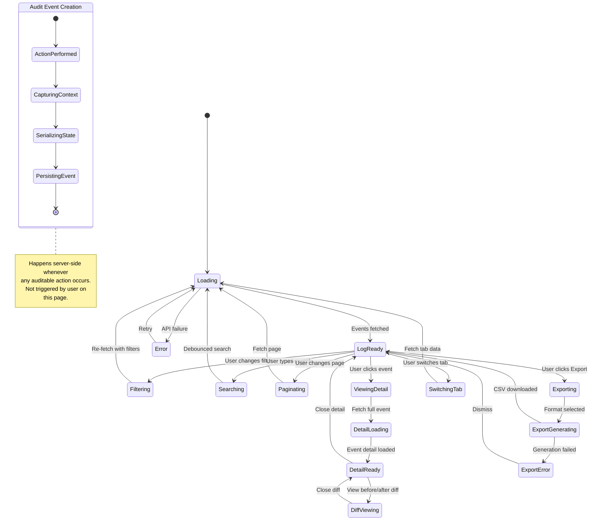

# Page 14 — Audit Log Page

**Route:** `/dashboard/audit`  
**Access:** Super Admin, Institution Admin (limited — own institution only)  
**Purpose:** Comprehensive audit trail of all system actions — login activity, config changes, rule modifications, report generation, and data access.

---

## Page Content & Layout

### Sections

| Section | Position | Description |
|---------|----------|-------------|
| Audit Stats Bar | Top | Total Events Today, Logins, Config Changes, Rule Changes |
| Filter Bar | Below Stats | Filter by user, action type, resource, date range, severity |
| Audit Log Table | Main | Chronological table of all audit events |
| Event Detail Panel | Side/Modal | Full detail of selected audit event |
| Activity Timeline | Tab | Visual timeline of events grouped by user |

### Audit Event Types

| Event Type | Icon | Description |
|------------|------|-------------|
| `auth.login` | 🔑 | User logged in |
| `auth.logout` | 🚪 | User logged out |
| `auth.failed` | ❌ | Failed login attempt |
| `config.updated` | ⚙️ | Configuration changed |
| `rule.created` | 📋 | New rule created |
| `rule.updated` | ✏️ | Rule modified |
| `rule.toggled` | 🔄 | Rule activated/deactivated |
| `warning.issued` | ⚠️ | Warning issued to student |
| `penalty.applied` | 🔴 | Penalty applied |
| `penalty.revoked` | 🟢 | Penalty revoked |
| `report.generated` | 📊 | Report generated |
| `student.created` | 👤 | Student profile created |
| `student.imported` | 📥 | Students bulk imported |
| `device.registered` | 🖥️ | New device registered |
| `backup.created` | 💾 | Database backup taken |
| `backup.restored` | ♻️ | Database restored from backup |

### Buttons & Interactive Elements

| Element | ID | Action |
|---------|----|--------|
| Filter by User | `select-audit-user` | Filter events by specific user |
| Filter by Type | `select-audit-type` | Filter by event type category |
| Filter by Resource | `select-audit-resource` | Filter by resource (config, rules, students, etc.) |
| Date Range Picker | `input-audit-date-range` | Filter by date/time range |
| Search | `input-audit-search` | Free-text search in event messages |
| Export Audit Log | `btn-export-audit` | Export filtered log as CSV |
| View Detail | `btn-audit-detail-{id}` | View full event detail |
| Refresh | `btn-refresh-audit` | Reload audit log |
| Tab: Log Table | `tab-audit-table` | Table view |
| Tab: Timeline | `tab-audit-timeline` | Timeline view grouped by user |
| Pagination | `nav-audit-pagination` | Navigate audit log pages |
| Page Size | `select-audit-page-size` | 25/50/100 per page |

---

## Class Diagram

```mermaid
classDiagram
    direction TB

    class AuditLogPage {
        +String activeTab
        +FilterState filters
        +String searchQuery
        +int page
        +int pageSize
        +onMount()
        +applyFilters()
        +search(query)
        +changePage(page)
        +exportLog()
        +switchTab(tab)
    }

    class AuditStatsBar {
        +Int totalToday
        +Int loginEvents
        +Int configChanges
        +Int ruleChanges
        +Int warningEvents
    }

    class AuditLogTable {
        +AuditEvent[] events
        +SortState sort
        +onSort(column)
        +onEventClick(eventId)
    }

    class AuditEventRow {
        +AuditEvent event
        +String typeIcon
        +String typeColor
        +String userName
        +String action
        +String resource
        +String summary
        +DateTime timestamp
        +onClick()
    }

    class AuditEventDetail {
        +AuditEvent event
        +String fullDescription
        +JSON beforeState
        +JSON afterState
        +String ipAddress
        +String userAgent
        +renderDiff()
    }

    class ActivityTimeline {
        +TimelineGroup[] groups
        +groupByUser()
        +groupByDay()
        +renderTimeline()
    }

    class AuditFilterBar {
        +String userId
        +String eventType
        +String resource
        +DateRange dateRange
        +String searchQuery
        +apply()
        +reset()
    }

    class AuditStore {
        +AuditEvent[] events
        +AuditStats stats
        +int totalCount
        +int page
        +Boolean isLoading
        +fetchEvents(filters, page)
        +fetchStats()
        +getEventDetail(id)
        +exportLog(filters, format)
    }

    class AuditApiClient {
        +getAuditEvents(filters, page) PaginatedEvents
        +getAuditEvent(id) AuditEventDetail
        +getAuditStats(period) AuditStats
        +exportAuditLog(filters, format) Blob
        +getAuditTimeline(filters) TimelineData
    }

    class AuditRouter {
        +GET /api/v1/audit
        +GET /api/v1/audit/{id}
        +GET /api/v1/audit/stats
        +GET /api/v1/audit/export
        +GET /api/v1/audit/timeline
    }

    class AuditService {
        -AuditRepository repo
        +log(event) void
        +listEvents(filters, pagination) PaginatedResult
        +getEventDetail(id) AuditEventDetail
        +getStats(period) AuditStats
        +getTimeline(filters) TimelineData
        +exportLog(filters, format) FileBytes
        +purgeOldEvents(retentionDays) int
    }

    class AuditEventModel {
        +UUID id
        +String event_type
        +String action
        +String resource_type
        +String resource_id
        +UUID user_id
        +String user_name
        +String user_role
        +String ip_address
        +String user_agent
        +String summary
        +JSON before_state
        +JSON after_state
        +JSON metadata
        +DateTime created_at
    }

    AuditLogPage --> AuditStatsBar : contains
    AuditLogPage --> AuditFilterBar : contains
    AuditLogPage --> AuditLogTable : tab table
    AuditLogPage --> ActivityTimeline : tab timeline
    AuditLogPage --> AuditEventDetail : opens
    AuditLogPage --> AuditStore : reads state
    AuditLogTable --> AuditEventRow : renders list
    AuditStore --> AuditApiClient : fetches
    AuditApiClient --> AuditRouter : HTTP requests
    AuditRouter --> AuditService : delegates
    AuditService --> AuditEventModel : queries
```

---

## State Diagram



---

## Feature-Action-Controller Map

| # | Feature | User Action | Frontend Controller | API Endpoint | Backend Service | Reaction / Side Effect |
|---|---------|-------------|-------------------|--------------|-----------------|----------------------|
| 1 | **Load Audit Log** | Page mount | `AuditStore.fetchEvents()` | `GET /api/v1/audit?page=1&size=50` | `AuditService.listEvents()` | Chronological table of events, newest first |
| 2 | **Load Stats** | Page mount | `AuditStore.fetchStats()` | `GET /api/v1/audit/stats` | `AuditService.getStats()` | Stats bar: today's total, logins, config changes, etc. |
| 3 | **Filter by User** | Selects user dropdown | `AuditFilterBar.apply()` | `GET /api/v1/audit?user_id={id}` | Service method | Table shows only events by selected user |
| 4 | **Filter by Type** | Selects event type | `AuditFilterBar.apply()` | `GET /api/v1/audit?event_type=config.updated` | Service method | Table filters to specific event type |
| 5 | **Filter by Resource** | Selects resource | `AuditFilterBar.apply()` | `GET /api/v1/audit?resource=rules` | Service method | Shows only events for selected resource |
| 6 | **Date Range** | Picks date range | `AuditFilterBar.apply()` | `GET /api/v1/audit?from=&to=` | Service method | Table shows events within date range |
| 7 | **Search** | Types search query | `AuditLogPage.search()` (debounced) | `GET /api/v1/audit?q=search_term` | Service method | Full-text search in event summaries |
| 8 | **View Detail** | Clicks event row | `AuditStore.getEventDetail()` | `GET /api/v1/audit/{id}` | `AuditService.getEventDetail()` | Side panel: full event, user info, IP, user agent |
| 9 | **View Diff** | Clicks "View Changes" in detail | `AuditEventDetail.renderDiff()` | — (data already loaded) | — | Before/after JSON diff for config/rule changes |
| 10 | **Timeline View** | Clicks Timeline tab | `AuditStore` | `GET /api/v1/audit/timeline` | `AuditService.getTimeline()` | Visual timeline grouped by user with event dots |
| 11 | **Export Log** | Clicks Export | `AuditStore.exportLog()` | `GET /api/v1/audit/export?format=csv` | `AuditService.exportLog()` | CSV download of filtered audit events |
| 12 | **Pagination** | Clicks page number | `AuditLogPage.changePage()` | `GET /api/v1/audit?page=3` | Service method | Table loads requested page |
| 13 | **Sort Events** | Clicks column header | `AuditLogTable.onSort()` | `GET /api/v1/audit?sort=created_at&order=asc` | Service method | Events sorted by selected column |
| 14 | **Auto-Purge** | Automatic (cron) | — | — (background task) | `AuditService.purgeOldEvents()` | Events older than retention period deleted |

---
